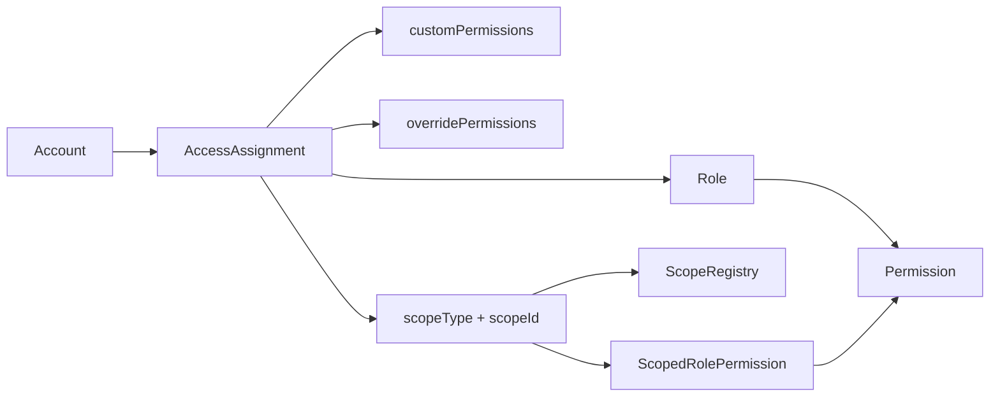
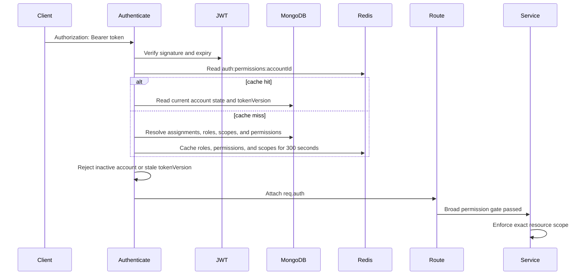

# RBAC Developer Guide

This guide explains how authorization works at runtime and how backend modules must enforce it. For endpoint payloads, use [AUTH_RBAC_API.md](./AUTH_RBAC_API.md).

## Core Model



| Record | Responsibility |
|---|---|
| `Account` | Credentials, account status, token version, and refresh sessions. It does not store roles. |
| `Role` | Reusable permission bundle such as `ADMIN`, `MANAGER`, `LEADER`, or `USER`. |
| `Permission` | Uppercase action code such as `ORDERS:READ` or `SHOPS:WRITE`. |
| `AccessAssignment` | Assigns one role to one account in one scope. This is the source of account authorization. |
| `ScopeRegistry` | Registers active `department`, `team`, `shop`, and `vendor` resources before Auth can assign them. |
| `ScopedRolePermission` | Replaces a role's default permissions for one exact `(scopeType, scopeId, roleId)`. |

Organization owns departments, teams, and memberships. Shop and Vendor own their business records. Auth only stores authorization references to those records.

## Scope Types

| Scope type | `scopeId` | Meaning |
|---|---:|---|
| `global` | `null` | Permission applies across all resources. |
| `own` | `null` | Permission applies to the authenticated account's own resource; the business service resolves ownership. |
| `department` | required | Permission applies to one department. |
| `team` | required | Permission applies to one team. |
| `shop` | required | Permission applies to one shop. |
| `vendor` | required | Permission applies to one vendor. |

Only active assignments participate in authorization. A scoped resource must have an active `ScopeRegistry` record before an assignment or scoped role rule can be created.

## Effective Permission Resolution

For every active `AccessAssignment`, Auth resolves permissions in this order:

1. Start with `Role.permissions`.
2. If an exact `ScopedRolePermission` exists, replace the role permissions with that scoped permission list.
3. If `AccessAssignment.overridePermissions` is present, replace the result with that list. An empty list intentionally grants no permissions for the assignment.
4. Otherwise, union `AccessAssignment.customPermissions` into the inherited permission list.
5. Resolve permission ObjectIds to uppercase permission codes and remove duplicates.

In compact form:

```text
inherited = exact scoped role rule ?? role.permissions
effective = assignment.overridePermissions ?? union(inherited, assignment.customPermissions)
```

Global assignments are flattened into top-level `req.auth.roles` and `req.auth.permissions`. All assignments, including global ones, remain available in `req.auth.scopes`. Public login and `/api/auth/me` responses omit the duplicated global entries from their `scopes` array.

Example auth context used internally:

```json
{
  "accountId": "507f1f77bcf86cd799439011",
  "email": "leader@example.com",
  "roles": [],
  "permissions": [],
  "scopes": [
    {
      "assignmentId": "507f1f77bcf86cd799439016",
      "scopeType": "team",
      "scopeId": "660000000000000000000101",
      "resourceId": "660000000000000000000101",
      "roles": ["LEADER"],
      "permissions": ["TEAMS:READ", "TEAMS:WRITE"]
    }
  ]
}
```

The empty top-level arrays are expected here: this account has a team assignment but no global assignment.

## Authenticated Request Flow



`authenticate` also loads the HR employee profile and applies the account-setup guard. Authentication failures return `401`; authorization failures return `403`.

Changing an email or password, revoking sessions, or archiving an account increments `tokenVersion`. Existing access tokens then fail on their next request even if authorization data was cached.

## Authorization Helpers

Other modules must import these helpers through `src/modules/auth/public.js`.

| Helper | What it checks | Use when |
|---|---|---|
| `authorizePermissions(...codes)` | Every requested permission exists in global permissions. | The endpoint is truly global. |
| `authorizeAnyPermission(...codes)` | At least one code exists in any global or scoped assignment. | Route-level precheck before the service resolves the target resource. |
| `authorizeScopedPermission(code, resolver)` | The code is global or belongs to the exact resolved scope. | The route already contains the trusted scope identity. |
| `canAccessScope(auth, code, scope)` | Same exact-scope decision as above, returned as a boolean. | Service filtering and resource-level authorization. |
| `authorizeRoles(...roles)` | Any requested role exists globally or in any scoped assignment. | Exceptional role-specific policy; permission checks are preferred. |
| `isSuperAdmin(auth)` | Top-level global roles contain `SUPER_ADMIN`. | Internal bypass checks. Do not reproduce this logic in modules. |

Important: `authorizeAnyPermission` proves that the account has a permission somewhere; it does not prove access to the requested shop, team, department, or vendor. A scoped endpoint must still call `canAccessScope` after loading the resource.

## Route Patterns

### Global endpoint

Use global permission middleware when the operation is not tied to one business scope:

```js
const authPublic = require('../../auth/public');

router.get(
  '/roles',
  authPublic.authenticate,
  authPublic.authorizePermissions('AUTH:READ'),
  asyncHandler(controller.listRoles),
);
```

### Scope is available in the route

Use scoped middleware when a route parameter directly identifies the protected resource:

```js
router.get(
  '/:shopId',
  authPublic.authenticate,
  authPublic.authorizeScopedPermission('SHOPS:READ', (req) => ({
    scopeType: 'shop',
    scopeId: req.params.shopId,
  })),
  asyncHandler(controller.getShop),
);
```

Validate route parameters before using them in a database query. Authorization does not replace input validation.

### Scope is discovered from the resource

For an order-item-style route, the URL id may not reveal its shop. Use a broad route gate, then enforce the loaded resource's scope in the service:

```js
router.get(
  '/:orderItemId',
  authPublic.authenticate,
  authPublic.authorizeAnyPermission('ORDERS:READ', 'ORDERS:WRITE'),
  asyncHandler(controller.getOrderItem),
);
```

```js
const orderItem = await repository.findById(orderItemId);
if (!orderItem) throw notFoundError();

const canRead = authPublic.canAccessScope(authContext, 'ORDERS:READ', {
  scopeType: 'shop',
  scopeId: orderItem.shopId,
}) || authPublic.canAccessScope(authContext, 'ORDERS:WRITE', {
  scopeType: 'shop',
  scopeId: orderItem.shopId,
});

if (!canRead) throw forbiddenError();
```

For list endpoints, derive the allowed scope ids from `req.auth.scopes` and include them in the repository filter. Filtering the response after an unrestricted query is not sufficient.

## Super Admin Behavior

An account bypasses authorization helpers only when it has an active global `SUPER_ADMIN` assignment. A scoped `SUPER_ADMIN` role is not a global bypass because `isSuperAdmin` reads only top-level global roles.

`ADMIN` receives the seeded permission set but is not a hard-coded bypass. Its access follows its resolved permissions like any other role.

## Cache And Invalidation

When Redis is enabled, resolved `roles`, `permissions`, and `scopes` are cached under:

```text
auth:permissions:<accountId>
```

The TTL is 300 seconds. Cache failures are logged and Auth falls back to MongoDB.

RBAC mutations must use Auth services because they invalidate affected accounts after changes to:

- account access assignments;
- role permissions;
- scoped role permissions;
- permission codes or assignment-specific permissions.

Do not write Auth models directly from another module. Cross-module calls must use `src/modules/auth/public.js`.

## Implementation Checklist

When protecting a new endpoint:

1. Reuse an existing `RESOURCE:ACTION` permission unless the workflow needs a distinct business action.
2. Add `authenticate` before every authorization middleware.
3. Decide whether the operation is global or resource-scoped.
4. If scoped, enforce the exact scope in middleware or in the service after loading the resource.
5. Apply the same scope filter to list, count, summary, export, and background-trigger endpoints.
6. Return `403` without revealing whether an out-of-scope resource exists when that distinction is sensitive.
7. Add one allowed case and one denied cross-scope case to the narrowest relevant test suite.

## Verification

```bash
npm run test:auth -- --runInBand
npm run test:architecture -- --runInBand
```

For seeded API verification, follow [RBAC_TEST_FLOW.md](./RBAC_TEST_FLOW.md) or import the [Auth/RBAC Postman collection](./postman/LNG_Web_BE_Auth_RBAC.postman_collection.json).

## Related Documents

- [Auth RBAC API](./AUTH_RBAC_API.md): request and response contracts.
- [Scoped role permissions](./RBAC_SCOPED_ROLE_PERMISSION.md): exact-scope override behavior and migration.
- [RBAC naming convention](./RBAC_NAMING_CONVENTION.md): role, permission, and scope naming.
- [RBAC test flow](./RBAC_TEST_FLOW.md): local seed and manual verification.
- [Organization API](../organization/ORGANIZATION_API.md): department, team, and membership ownership.
