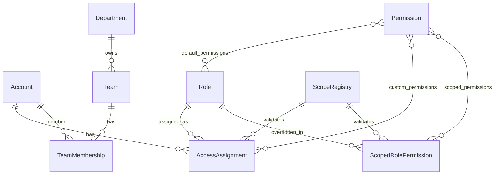

# RBAC Scoped Role Permission

`ScopedRolePermission` is the canonical permission override model for role permissions inside a concrete scope.

Department-specific permission overrides use this same model with `scopeType: "department"` and `scopeId` set to the department id.

## ERD



## API Contract

### GET `/api/auth/scoped-role-permissions`

Query:

- `scopeType`: `department`, `team`, `shop`, or `vendor`
- `scopeId`
- `roleId`
- `page`
- `limit`

### PUT `/api/auth/scoped-role-permissions`

```json
{
  "scopeType": "team",
  "scopeId": "507f1f77bcf86cd799439088",
  "roleId": "507f1f77bcf86cd799439012",
  "permissionIds": ["507f1f77bcf86cd799439013"]
}
```

The service validates role, permissions, active scope registry entry, and invalidates auth cache for accounts using the role.

## Service Rules

- Effective scoped permissions prefer `ScopedRolePermission` for the exact `(scopeType, scopeId, roleId)`; otherwise they use `Role.permissions`.
- `AccessAssignment.customPermissions` are unioned after role/scoped permissions and remain admin-only.
- Plain `authorizePermissions` checks only global permissions.
- Scoped operations must use `canAccessScope` or `authorizeScopedPermission`.
- Manager membership writes are allowed only when the actor has `TEAMS:WRITE` for the target team department.
- Promoting a member to leader ensures a team-scoped `LEADER` assignment and deactivates the team-scoped `USER` assignment.
- Demoting a leader to member ensures a team-scoped `USER` assignment and deactivates the team-scoped `LEADER` assignment.
- Removing or moving a member deactivates team-scoped role assignments for the old team.

## Migration

Run:

```bash
npm run migrate:rbac:scoped-role-permissions
```

The migration is idempotent. It reads legacy `departmentrolepermissions` records and upserts matching `scopedrolepermissions` records with `scopeType: "department"`.
