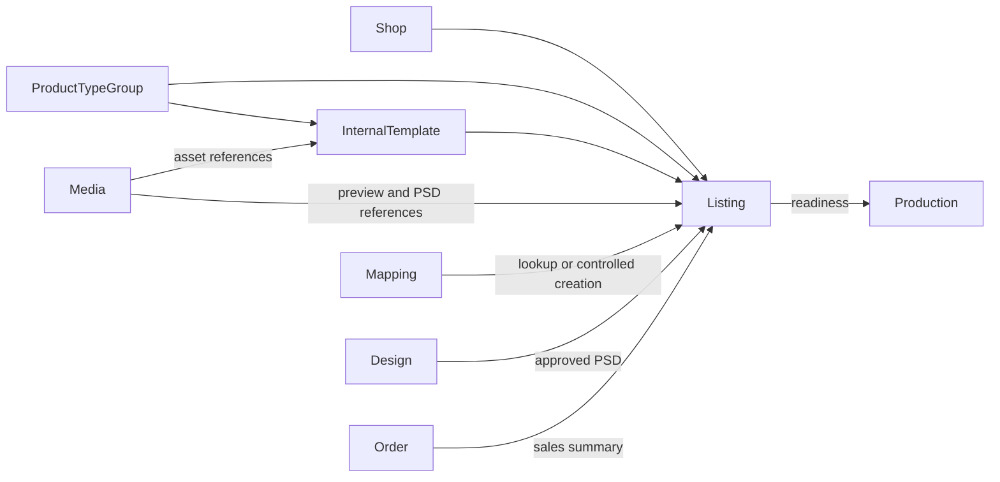

# Catalog Module Developer Guide

The Catalog module owns the internal listing setup required to turn marketplace demand into a mapped POD product.

Base path: `/api/catalog`.

## Current Scope

The current implementation has three aggregates:

| Aggregate | Responsibility |
|---|---|
| `ProductTypeGroup` | Global product-family taxonomy and display order. |
| `InternalTemplate` | Global customer-input schema, artwork slots, and reusable design assets for one product type group. |
| `Listing` | Shop/channel marketplace item linked to a product type group, optional internal template, setup state, and QC state. |

There are no separate `Product`, `Variant`, `ProductType`, or `ProductionTemplate` models in the current module. Do not document or import them as if they exist. `ProductTypeGroup` and `InternalTemplate` are the implemented setup concepts.

## Boundary



Catalog does not own:

- marketplace credentials or synchronization;
- source order items;
- vendor products, cost-center routing, or fulfillment plans;
- design review workflow;
- production tasks;
- binary file storage.

Those modules communicate through `src/modules/catalog/public.js`.

## Product Type Groups

`ProductTypeGroup` fields are `code`, `name`, `sortOrder`, and `status`.

- `code` is uppercase, unique, and immutable through the HTTP PATCH contract.
- `sortOrder` is an integer used before name/code for display ordering.
- status is `ACTIVE` or `INACTIVE`.
- new Listings and Internal Templates require an active group.

Product type groups are global master data, not shop-scoped records. Their routes therefore require global `CATALOG:READ` or `CATALOG:WRITE` via `authorizePermissions()`.

Disabling a group does not rewrite existing Listings or Templates. It prevents the group from passing active-reference validation for new or changed setup.

## Internal Templates

An `InternalTemplate` belongs to one Product Type Group and has an immutable uppercase code.

### Required fields

Each field defines:

```text
key, label, type, required, source, validation, sortOrder
```

Field types:

```text
TEXT | IMAGE | OPTION | FILE | NUMBER | DATE | UNKNOWN
```

Sources:

```text
CUSTOMER_INPUT | AMAZON_CUSTOMIZATION | MANUAL | SYSTEM
```

Keys must be safe identifiers beginning with a letter and containing only letters, digits, or underscores. Required-field keys must be unique.

### Artwork slots

Artwork slots declare what production/design output must be assembled:

```text
key, label, type, required, acceptedFieldKeys, outputRole, sortOrder
```

Slot types are `IMAGE`, `TEXT`, `VECTOR`, `PDF`, or `MIXED`. Every `acceptedFieldKeys` entry must reference a declared required-field key; slot keys must also be unique.

### Design assets

Template design assets store only Media references with type, version, label, status, and metadata. Supported types include `PSD_TEMPLATE`, `PREVIEW_IMAGE`, `MASK_FILE`, `SVG_TEMPLATE`, `SAMPLE_OUTPUT`, and `OTHER`.

Every referenced `mediaAssetId` is checked through the Media public port before create/update. Catalog must never store binary data inside the template document.

`requiresPsd=false` makes an active template's listing PSD readiness `NOT_REQUIRED`.

## Listing Identity

A Listing is owned by one Shop and marketplace context. Its stable SKU identity is:

```text
shopId + salesChannelCode + marketplaceCode + sku
```

When ASIN is present, this identity is also unique:

```text
shopId + salesChannelCode + marketplaceCode + asin
```

`etsyListingId` is indexed for filtering but is not currently a unique key or a public lookup priority.

Identity fields are immutable through PATCH:

- `shopId`
- `salesChannelCode`
- `marketplaceCode`
- `sku`

SKU, ASIN, channel, and marketplace values are normalized to uppercase where defined by the schema/validator. Monetary `baseCostAmount` is a non-negative integer in minor units with a three-character currency.

## Listing Lookup And Creation

`findListingForOrderItem()` searches only active, approved Listings within the exact Shop/channel/marketplace:

1. ASIN;
2. canonical SKU;
3. fallback/original SKU.

This is the current code order. `etsyListingId` is not part of this lookup.

Order import does not create Listings directly. Mapping may call `findOrCreateListingForOrderItem()` only when its recheck explicitly enables `createMissingListing`, has resolved an unambiguous Product Type Group, and has enough listing data.

Mapping-created Listings start as:

```text
status=ACTIVE
qcStatus=APPROVED
costCenterStatus=MISSING
psdStatus=MISSING
baseCostAmount=0
```

The create port rechecks for a winning active/approved Listing after a duplicate-key race. Manual HTTP creation starts with the model defaults, including `qcStatus=DRAFT`, and may best-effort create a PSD Design task when the stored listing PSD status is missing.

## Setup And QC Status

Listing record status:

```text
ACTIVE | INACTIVE
```

Listing QC status:

```text
DRAFT -> APPROVED
DRAFT -> REJECTED
```

Only draft Listings can be approved or rejected. There is no reopen or second QC transition in the current API. Approval records actor/time and clears rejection metadata; rejection requires a reason and clears approval metadata.

Setup fields use:

```text
costCenterStatus: MISSING | PRESENT
psdStatus:        MISSING | PRESENT
```

`costCenterStatus` is editable setup metadata. `psdStatus` is not accepted by the normal Listing PATCH endpoint; PSD state changes through approved asset workflows.

## Effective PSD Readiness

Consumers should use `getListingPsdReadiness()` or DTO `psdReadiness`, not infer readiness from stored `Listing.psdStatus` alone.

Resolution order:

1. active Internal Template with `requiresPsd=false` -> `NOT_REQUIRED`;
2. Listing's direct `psdTemplateAssetId` -> `PRESENT`, source `LISTING`;
3. active Template's first active `PSD_TEMPLATE` design asset -> `PRESENT`, source `TEMPLATE`;
4. otherwise -> `MISSING`.

The result includes `required`, `status`, `effectivePsdAssetId`, and `source`.

### Direct admin upload

`POST /listings/:id/psd-template` is an admin/backfill path requiring global `CATALOG:WRITE`. It accepts `.psd`, `.zip`, or `.rar` up to 200 MiB, streams the file to Media, sets the direct Listing asset and `psdStatus=PRESENT`, then removes the temporary upload.

After persistence, Catalog attempts these follow-up actions independently:

- resolve an active PSD Design task;
- recheck Production tasks blocked by PSD;
- refresh linked Order PSD aggregate statuses.

Follow-up failures do not roll back the stored PSD. They are returned as warnings and logged.

Normal operations should use the Design task submit/review flow. Design approval calls the Catalog public port, which validates the existing Media asset shape before assigning it.

## Preview Assets

Listings store only `previewAssetId`. HTTP create/update accepts an existing Media id and verifies it.

Mapping can call `setListingPreviewFromSourceUrl()` to fill a missing preview from customization. The function:

- returns without downloading if a preview already exists;
- fetches through the shared safe remote-fetch boundary;
- limits the response to 15 MiB;
- streams it into Media;
- stores a redacted URL and hash in Media metadata;
- saves only the Media id on Listing.

## Read Models

Listing list/detail DTOs can enrich records with:

- Product Type Group and Internal Template summaries;
- effective PSD readiness;
- preview and direct PSD Media download references;
- Shop summary;
- seller name derived when SKU begins with an employee code such as `J123-...`;
- Order sales statistics: order count, item count, quantity sold, and last sold time.

Supported sales sorts are `orderCountDesc`, `quantitySoldDesc`, and `lastSoldAtDesc`. They currently load the filtered Listing set and sort in memory; move this to an aggregation only when measured catalog volume requires it.

## Authorization

| Surface | Authorization |
|---|---|
| Product Type Groups | Global `CATALOG:READ` / `CATALOG:WRITE` |
| Internal Templates | Global `CATALOG:READ` / `CATALOG:WRITE` |
| Listing list/detail | Global or exact shop-scoped `CATALOG:READ`; write also satisfies read |
| Listing create/update/QC | Global or exact shop-scoped `CATALOG:WRITE` |
| Direct PSD upload | Global `CATALOG:WRITE` |

Listing routes perform a coarse permission check; services filter lists and enforce the loaded or requested Shop. No readable Shop returns an empty page/summary.

## Public Port

`src/modules/catalog/public.js` exposes:

| Group | Capabilities |
|---|---|
| Listing lookup | Find by SKU or OrderItem context; controlled find-or-create. |
| Listing reads | List, get one/many, and compact summaries. |
| Readiness/assets | Resolve PSD readiness, assign a validated PSD asset, and set preview from a source URL. |
| Taxonomy | Get/find Product Type Groups. |
| Templates | Get/find Internal Templates and resolve the template for a Listing. |

Public read helpers are trusted internal capabilities and do not all accept an auth context. HTTP controllers must use the authorization-aware service methods.

## Endpoint Groups

| Group | Paths |
|---|---|
| Product types | `GET/POST /product-type-groups`, `PATCH /product-type-groups/:id` |
| Templates | `GET/POST /internal-templates`, `GET/PATCH /internal-templates/:id` |
| Listings | list, summary, create, detail, and update under `/listings` |
| QC | `POST /listings/:id/approve`, `/reject` |
| PSD backfill | `POST /listings/:id/psd-template` |

See [CATALOG_API.md](./CATALOG_API.md) for request and response examples.

## Development Checklist

1. Keep global taxonomy/templates separate from shop-scoped Listings.
2. Preserve SKU and optional ASIN compound uniqueness.
3. Validate active Shop, Product Type Group, and compatible Internal Template on create/change.
4. Use Media public ports and persist only asset references.
5. Use effective `psdReadiness` for production gates.
6. Keep QC transitions out of generic PATCH.
7. Enforce exact Listing Shop scope in services.
8. Return DTOs and keep lean Mongoose reads in repositories.
9. Use Catalog public ports from Mapping, Design, Production, and Order flows.
10. Run Catalog tests and the architecture contract.

```bash
npm test -- --runInBand tests/catalog
npm run test:architecture -- --runInBand
```
