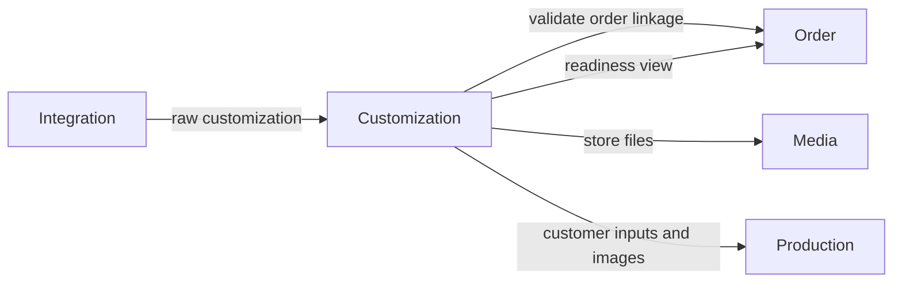

# Customization Module Developer Guide

The Customization module owns buyer-customization payloads from intake through normalized review data and Media asset references.

Base path: `/api/customizations`.

## Boundary



Customization owns:

- immutable source payload snapshots and their deterministic hashes;
- normalized customization data;
- source URL, downloaded Media references, ZIP manifests, and extracted-image references;
- parse errors, manual-review state, and retry metadata.

It does not own source-file parsing, Order or OrderItem persistence, catalog mapping, vendor selection, production tasks, shipments, or binary storage. Cross-module callers use `src/modules/customization/public.js`.

## Data Model

`CustomizationPayload` is shop-scoped and linked to exactly one OrderItem and Order. Before creation, the service loads the OrderItem through `order/public.js` and verifies both `orderId` and `shopId`.

Core fields:

| Group | Fields |
|---|---|
| Identity | `orderItemId`, `orderId`, `shopId`, `source`, optional `rawRecordId` |
| Source | `rawCustomization`, `rawCustomizationHash` |
| Result | `parsedData`, `status`, `errorCode`, `errorMessage` |
| Assets | `assets[].assetId`, `sourceUrl`, `type`, `status`, `metadata` |
| Attempts/review | `retryCount`, `lastTriedAt`, `reviewedBy`, `reviewedAt`, `createdBy` |

The unique key is `(orderItemId, rawCustomizationHash)`. Multiple source versions may exist for one item; item reads return the newest by `createdAt` and `_id`.

The DTO deliberately excludes `rawCustomization` and `rawCustomizationHash`. It also removes local filesystem paths and redacts source URL paths/query strings before returning derived views.

## Idempotent Intake

Integration creates a payload through:

```js
const customizationPublic = require('../../customization/public');

await customizationPublic.createPendingPayload({
  orderItemId,
  orderId,
  shopId,
  source,
  rawRecordId,
  rawCustomization,
});
```

Supported sources are `AMAZON_EXTENSION_REPORT` and `MANUAL_EXCEL`.

The service canonicalizes object keys before hashing, so equivalent objects with different key order produce the same hash. It returns `{ payload, created: false }` for an existing payload and recovers duplicate-key races by loading the winning record.

Invalid, empty, or mismatched Order linkage fails before persistence. The import pipeline must call this public port instead of writing the model directly.

## Parse Flow

`parseForOrderItem()` loads the newest payload and selects the parser from the raw shape:

- `variations` or `personalization` present: Etsy normalization;
- otherwise: Amazon normalization.

Both parsers produce `parsedData`, an asset manifest, an outcome, and optional error details. Valid HTTP(S) customization URLs become pending `CUSTOMIZED_URL` or `CUSTOMIZED_PAGE` asset entries. Missing evidence, conflicting flags, invalid URLs, or a photo value without a usable URL become `NEEDS_REVIEW`; valid data becomes `PARSED`.

Parsing does not download files. It only normalizes data and discovers asset references.

## Status Semantics

Payload statuses are:

```text
PENDING | DOWNLOADING | DOWNLOADED | EXTRACTING | PARSED | NEEDS_REVIEW | FAILED
```

Current automated parsing writes `PARSED` or `NEEDS_REVIEW`. Manual endpoints can write `PARSED`, `NEEDS_REVIEW`, or `FAILED`. Asset download updates each asset to `DOWNLOADED` or `FAILED`; it does not currently advance the payload through `DOWNLOADING`, `DOWNLOADED`, or `EXTRACTING`.

There is no transition matrix enforcing previous status. Do not treat the status list as a guaranteed sequential state machine.

`assertCustomizationReady(orderItemId)` accepts only the newest payload with status `PARSED`; otherwise it returns `409 CONFLICT_ERROR` with `PAYLOAD_NOT_READY`.

`retryCount` and the repository increment helper exist, but current HTTP/automation flows do not increment payload retry count. Asset retry is controlled independently by `retryFailed=true`.

## Asset Download

`downloadAssetsForOrderItem()` processes only `CUSTOMIZED_URL` assets:

1. skip already downloaded assets;
2. skip failed assets unless `retryFailed=true`;
3. fetch one asset at a time through the shared safe remote-fetch utility;
4. enforce timeout, redirect, byte, address, and response-type safeguards there;
5. stream the binary to `media.public.storeAsset()`;
6. persist the Media id, hash, size, MIME type, classification, and redacted URL metadata.

The default remote download ceiling is 10 MiB with three redirects. Do not replace streaming with an in-memory buffer or persist signed source URLs in DTOs.

## ZIP Inspection And Extraction

Inspection uses a downloaded Media asset and records a manifest in asset metadata. Default limits are:

| Limit | Default |
|---|---:|
| Entries | 50 |
| Total uncompressed bytes | 50 MiB |
| One entry uncompressed bytes | 20 MiB |

Path traversal, absolute/drive paths, encrypted entries, symlinks, unsafe executables, invalid sizes, and size-limit violations are errors. Nested archives and unknown extensions are warnings. The inspection result is `INSPECTED`, `NEEDS_REVIEW`, or `FAILED`; this is asset metadata, not the payload status.

Image extraction currently:

- re-fetches the ZIP source URL into a unique temporary directory;
- extracts safe `.jpg`, `.jpeg`, and `.png` entries to Media;
- parses `.json` entries up to 1 MiB;
- links parsed customer image names to extracted Media assets;
- reuses images already recorded for the same normalized ZIP path;
- records partial failures without discarding successful images;
- always removes the temporary directory.

Inspection and extraction are separate operations. Inspection does not extract, and extraction does not require a prior inspection result.

## Authorization

All non-health HTTP routes require authentication.

| Operation | Permission |
|---|---|
| List and detail | `ORDERS:READ` globally or for the exact Shop |
| Create, status changes, download, inspect, extract | `ORDERS:WRITE` globally or for the exact Shop |

Routes check the permission code; services enforce the loaded payload's `shopId`. Lists are filtered to readable Shop ids and return an empty page when the caller has no readable scope or requests an unauthorized Shop.

Public-port calls without an auth context are trusted internal calls. Do not expose that convention at an HTTP boundary.

## Replacement Behavior

Order replacement calls `cloneLatestPayloadForReplacement()`. If the original item has a payload, the clone keeps its raw data, parsed data, assets, status, errors, and review metadata while changing Order, OrderItem, and Shop linkage. If no original payload exists, the function returns `null`.

The clone is an internal carry-forward, not a fresh parse or asset download.

## Public Port

`src/modules/customization/public.js` exposes:

| Group | Capabilities |
|---|---|
| Intake | Create an idempotent pending payload; clone the newest payload for a replacement. |
| Read models | Read the newest payload, compact item view, or batch of compact item views. |
| Parse/review | Parse raw data and mark manual review. |
| Assets | Download source assets; inspect ZIPs; extract ZIP images by OrderItem or payload. |
| Readiness | Assert that the newest payload is `PARSED`. |

Keep raw repository/model access private. Add a public function only for a real cross-module capability.

## Endpoint Groups

| Group | Paths |
|---|---|
| Read | `GET /`, `GET /:payloadId`, `GET /order-items/:orderItemId` |
| Intake | `POST /pending` |
| Manual state | `PATCH /:payloadId/needs-review`, `/failed`, `/parsed` |
| Assets | `POST /order-items/:orderItemId/download-assets`, `/inspect-zip`, `/extract-zip-images` |

See [CUSTOMIZATION_API.md](./CUSTOMIZATION_API.md) for payloads and response shapes.

## Development Checklist

1. Validate OrderItem, Order, and Shop linkage before persistence.
2. Preserve hash-based idempotency and duplicate-race recovery.
3. Enforce exact Shop scope after loading the payload.
4. Keep raw customization and unredacted URLs out of DTOs and logs.
5. Use Media public ports for binaries; keep only references here.
6. Keep all Mongoose access in the repository and use lean reads.
7. Keep ZIP traversal, encryption, symlink, size, and cleanup protections intact.
8. Update API docs when a public route or port changes.
9. Run Customization tests and the architecture contract.

```bash
npm test -- --runInBand tests/customization
npm run test:architecture -- --runInBand
```
