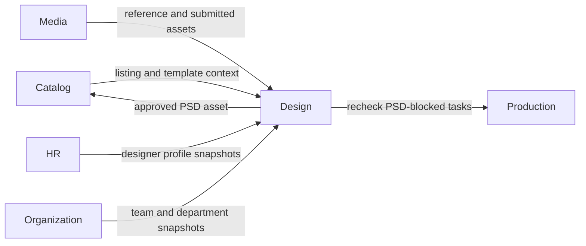
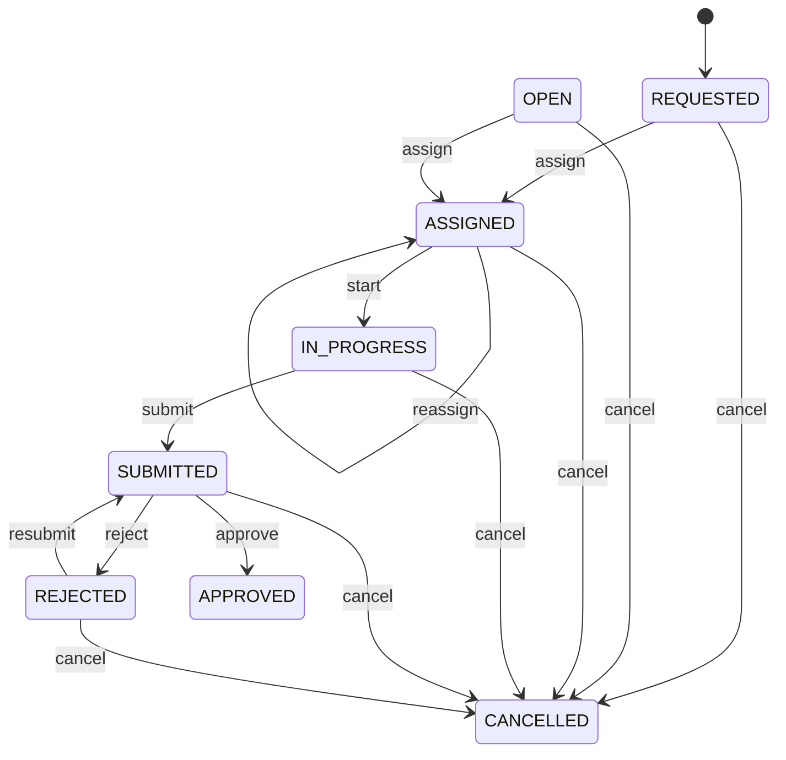

# Design Module Developer Guide

The Design module owns listing-centered creative work: task assignment, versioned file submissions, review, approved-output selection, and KPI scoring. Its PSD approval flow supplies Catalog readiness and unblocks Production.

Base path: `/api/design`.

## Boundary



Design owns `DesignTask`, embedded submission history, and `DesignSubmissionScore`. It does not own Listings, binary storage, employee profiles, organization membership, or Production tasks. Cross-module calls go through each target module's `public.js`.

## Task Types And Outputs

Task types:

```text
PSD_TEMPLATE | MOCKUP | PNG_ASSET | IDEA | CLONE
```

Expected output types:

```text
PSD_TEMPLATE | MOCKUP | PNG_ASSET | IDEA
```

Every task targets one Listing. `IDEA` requires a brief. `CLONE` requires a source Listing or source Internal Template; its `listingId` remains the target Listing in V1. Reference Media ids are validated before creation.

The task stores Listing and Internal Template snapshots so the work brief remains stable when Catalog master data changes. Enriched DTOs separately resolve current designer, Shop, Media, score, and blocked-order context.

## Identity And Active-Task Rule

The database permits only one active task for the same:

```text
listingId + taskType
```

Active statuses are `REQUESTED`, `OPEN`, `ASSIGNED`, `IN_PROGRESS`, `SUBMITTED`, and `REJECTED`. `APPROVED` and `CANCELLED` are terminal for the uniqueness constraint, so a later task of the same type may be created.

Normal creation writes `REQUESTED`. `OPEN` remains a supported/readable status, but no current HTTP action transitions a task into `OPEN`.

PSD helper creation is idempotent: it returns the existing active PSD task and also handles duplicate-key races. Bulk creation processes at most 100 Listings and reports `CREATED`, `EXISTING`, `SKIPPED`, or `FAILED` per item.

## Task State Machine



Reassignment preserves the first `assignedAt`. Rejection requires a reason and allows direct resubmission without another start action.

## Submission History

Submit requires at least one existing Media asset. Each submit:

- deduplicates asset ids;
- creates the next integer submission version;
- records submitter, time, note, and `SUBMITTED` status;
- replaces the task-level `submittedAssetIds` convenience field with that version's assets;
- moves the task to `SUBMITTED`.

Review selects a submission by `submissionId`, by `version`, or defaults to the latest still `SUBMITTED` version. Only an asset belonging to that version can be approved.

Submission states are `SUBMITTED`, `APPROVED`, `REJECTED`, and `REMOVED`. Removal is a soft history change and is forbidden for an approved submission. It does not currently recalculate the task status or clear task-level latest-submission fields.

Legacy tasks without embedded submissions are projected as a synthetic version 1 from task-level submitted fields.

## PSD Approval And Handoff

Approval updates the target Listing PSD when:

- task type is `PSD_TEMPLATE`;
- task type is `CLONE` and `expectedOutputs` contains `PSD_TEMPLATE`; or
- task type is `CLONE` and the approved Media filename/MIME looks like PSD, ZIP, or RAR.

Catalog validates and assigns the Media asset before Design marks the task/submission approved. After approval, Design creates an idempotent score and best-effort rechecks Production tasks blocked by missing PSD. Production failures are returned as warnings and do not roll back approval.

The Catalog direct PSD upload/backfill path can call `resolveActivePsdTaskForListing()`. It approves an existing active PSD task, reuses a matching submitted version or synthesizes an approved version, and returns `NO_ACTIVE_TASK` when none exists. This compatibility path does not create KPI score rows inside Design.

Catalog assignment and Design persistence are not one Mongo transaction. A Catalog update can therefore succeed before a later Design write fails. Likewise, score creation runs after the approved task write; an error there does not undo the stored approval even though the request may fail.

## Submission Scoring

An approved submission produces at most one score for:

```text
taskId + submissionId + approved assetId
```

Default base points:

| Task type | Points |
|---|---:|
| `PSD_TEMPLATE` | 3 |
| `IDEA` | 2 |
| `MOCKUP` | 1 |
| `PNG_ASSET` | 1 |
| `CLONE` | 1 |

Priority multipliers are `1` for LOW/NORMAL, `1.25` for HIGH, and `1.5` for URGENT. Final points are rounded to two decimals. A multiplier above 1 yields score level `HARD`; otherwise the default is `STANDARD`.

The score snapshots designer name, team, and department at approval time. Later HR/Organization changes do not rewrite historical attribution.

Reviewers can override non-negative final points, optionally change level, and must provide a reason. Override keeps base/rule evidence. Void targets one active task/submission/asset score, requires a reason, preserves points as history, and changes status from `ACTIVE` to `VOIDED`. KPI summary counts only active scores.

## Read Workspaces

| Surface | Purpose |
|---|---|
| `/tasks` | Filtered task queue and enriched rows. |
| `/tasks/workload` | Status/type totals and active workload per designer. |
| `/tasks/summary` | Compact badge/dashboard counts. |
| `/assignees` | Assignable HR profiles plus active task counts. |
| `/tasks/psd-template/candidates` | Catalog Listings with missing PSD and no active PSD task. |
| `/psd-files` | Flattened PSD reference/submission/approved asset links. |
| `/submission-scores` | Shop-scoped PSD score rows with file and scorer metadata. |
| `/score-summary` | Active KPI totals by designer and task type. |

Filename search asks Media for case-insensitive prefix-matching asset ids, then applies those ids inside task/score queries. `/psd-files` roles are `REFERENCE`, `SUBMISSION`, and `APPROVED`.

## Authorization

| Action | Permission and scope |
|---|---|
| Full task/workspace read | `DESIGN:READ`, `DESIGN:REVIEW`, or `DESIGN:WRITE`, global or exact Shop scope. |
| Designer read/work | `DESIGN:WORK`; only tasks assigned to the current account and an allowed Shop. |
| Create, assign, cancel, remove submission | `DESIGN:WRITE` for the target Shop. |
| Start and submit | `DESIGN:WRITE`, or assigned designer with `DESIGN:WORK` for the Shop. |
| Approve and reject | `DESIGN:REVIEW` or `DESIGN:WRITE` for the Shop. |
| Score override and void | `DESIGN:REVIEW` or `DESIGN:WRITE`; service reloads the task and enforces its Shop. |

Route middleware accepts any design permission on read surfaces, then task/file/score-list services narrow data. A work-only caller is forced to their own `assignedDesignerId`; scoped full readers receive only allowed Shops. The assignee directory still returns the current global assignable-profile list; Shop scope affects its workload counts, not which profiles are listed.

Current exception: `GET /score-summary` authorizes at the route but its service/repository does not apply task Shop scope and accepts no `shopId`. It aggregates all matching active score rows. Treat it as a global KPI surface until scoped aggregation is implemented; do not claim tenant isolation for this endpoint.

## Public Port

`src/modules/design/public.js` intentionally exposes only:

- `createPsdTemplateTaskFromListing()` for Mapping/Production-style handoff;
- `resolveActivePsdTaskForListing()` for Catalog direct PSD upload compatibility;
- `getTask()` for an authorization-aware task read.

Other modules must not import Design services, repositories, or models.

## Audit Boundary

Task/submission/score records contain actors, timestamps, reasons, snapshots, and soft states. The current Design lifecycle is intentionally not registered in the central Audit event catalog. Do not describe these records as central immutable Audit events.

## Endpoint Groups

| Group | Paths |
|---|---|
| Task reads | `GET /tasks`, `/tasks/:id`, `/tasks/:id/submissions`, `/tasks/workload`, `/tasks/summary` |
| PSD workspaces | `GET /assignees`, `/tasks/psd-template/candidates`, `/psd-files` |
| Task creation | `POST /tasks`, `/tasks/from-listings/:listingId/psd-template`, `/tasks/bulk-create-psd-from-listings` |
| Lifecycle | `PATCH /tasks/:id/assign`, `/start`, `/submit`, `/approve`, `/reject`, `/cancel` |
| Submission history | `DELETE /tasks/:taskId/submissions/:submissionId` |
| Scoring | `GET /score-summary`, `/submission-scores`; score override and asset-specific void PATCH routes |

Request bodies and query examples are in [DESIGN_API.md](./DESIGN_API.md).

## Change Checklist

- Keep the one-active-task-per-Listing/type invariant and duplicate-race handling.
- Preserve Shop scope and assigned-designer restrictions in repository queries, not only response filtering.
- Validate Media references before persistence and approved assets against the selected submission.
- Keep submission versions and soft removal history intact.
- Update Catalog before claiming PSD readiness, then recheck Production best-effort.
- Keep score identity asset-specific and reviewer mutations task-Shop-aware.
- Document or fix cross-module partial-failure behavior when changing approval order.
- Run `npm test -- --runInBand src/test/design` and `npm run test:architecture -- --runInBand`.
