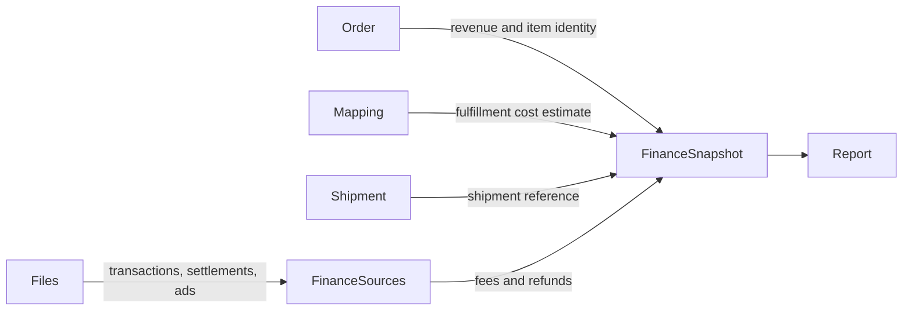

# Finance Module Developer Guide

The Finance module owns normalized marketplace finance source rows, immutable import-batch evidence, and one current financial snapshot per Order Item. Imports persist source facts; explicit recalculation materializes those facts with Order, Mapping, Shipment, HR, and Organization context for reporting.

Base path: `/api/finance`.

## Boundary And Flow

Finance does not own Orders, fulfillment routing, Shipments, or vendor invoices. It stores source rows and calculated read models; all cross-module access uses public ports.

## Import Pipeline

Supported sources are `TRANSACTIONS`, `SETTLEMENTS`, and `ADS`. Multipart uploads are capped at 25 MiB, stored as a Media asset, parsed row-by-row, and recorded in a replayable `FinanceImportBatch`.

Dry-run defaults to `true`. It still stores the source asset and batch evidence, but does not upsert normalized settlement, ledger, fee, refund, or ad-spend rows. Live row writes are idempotent through stable import identities. Unlinked marketplace rows are retained with null internal Order references and counted separately.

Batch status is `COMPLETED`, `PARTIAL_FAILED`, or `FAILED` from processed/skipped/error counts. Reprocess reads the original Media asset and creates a new batch; it never mutates the source batch. Imported source records have read endpoints only.

Importing does not recalculate Finance Snapshots. Call an Order Item or Order recalculation explicitly after source data changes.

## Snapshot Calculation

`FinanceSnapshot.orderItemId` is unique. Recalculation loads the current Order Item, fulfillment plan, Shipment, linked fee/refund totals, and seller/team dimensions, then atomically upserts the snapshot with its central Audit event.

All amounts are integer minor units; ratios are basis points. Revenue fields are derived from Order pricing, while imported linked fee/refund totals override legacy embedded finance values.

Two profit projections are intentionally distinct:

- stored `grossProfitAmount` uses `customerPaid - fee - refund - discount - baseCost`;
- response `orderPnl.profitAmount` uses total fulfillment cost and exposes additional cost separately.

Missing fulfillment cost produces `MISSING_COST`/`MISSING`, with null cost-dependent profit fields. Snapshot aggregation nulls incomplete currency profit totals rather than presenting partial results as final. Ad spend remains aggregate-only until it can be attributed to an Order.

## Seller And Operating Cost Attribution

Seller identity is derived from the Order Item SKU employee-code prefix, then enriched through HR and Organization. Seller/team reports apply a daily operating cost of 3000 minor units for the `SALES` team over the selected date range; this is a reporting adjustment, not an Order Item cost line.

## Authorization And Audit

Reads accept `FINANCE:READ` or `FINANCE:WRITE`; imports/reprocess/recalculation require `FINANCE:WRITE`. Services enforce global or exact Shop scope. Lists return only allowed Shops; entity reads validate the stored Shop.

Snapshot recalculation and its Audit event share a Mongo transaction, so either both commit or both abort. Import Audit is best-effort after batch completion. Sensitive snapshot/import/source-data reads also emit central Audit records with bounded filter metadata, never raw financial rows or file contents.

## Public Port

`src/modules/finance/public.js` exposes snapshot reads/recalculation plus daily, seller, team, and ads aggregations for Report. Import internals are deliberately not public. Other modules must not import Finance repositories or models.

## Endpoint Groups

| Group | Paths |
|---|---|
| Imports | `POST /imports/transactions`, `/imports/settlements`, `/imports/ads` |
| Import evidence | `GET /import-batches`, `/:batchId`, `POST /:batchId/reprocess` |
| Source reads | `GET /imported-data/:sourceType` |
| Snapshots | `GET /snapshots`, `/order-items/:orderItemId/snapshot` |
| Recalculation | `POST /order-items/:orderItemId/recalculate`, `/orders/:orderId/recalculate` |
| Order summary | `GET /orders/:orderId/summary` |

File contracts, formulas, and response examples are in [FINANCE_API.md](./FINANCE_API.md).

## Change Checklist

- Keep every monetary field in integer minor units and ratios in basis points.
- Preserve import idempotency, immutable batch history, dry-run semantics, and replay from Media.
- Do not imply imports update snapshots; require explicit recalculation.
- Keep missing-cost profit null and distinguish base-cost gross profit from total-cost Order P&L.
- Enforce Shop scope and exclude raw financial/source payloads from Audit metadata.
- Keep recalculation and its Audit record in one transaction.
- Run `npm test -- --runInBand src/test/finance` and the architecture suite.
