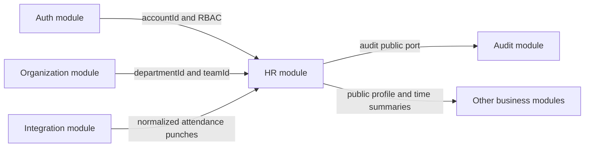
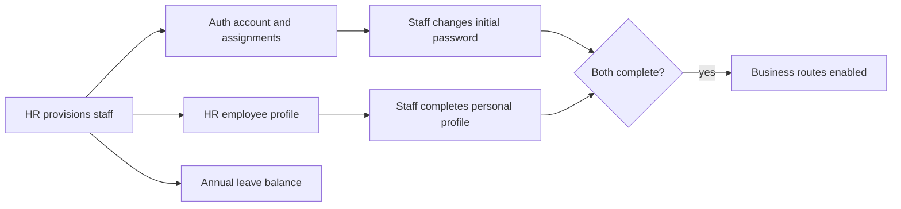
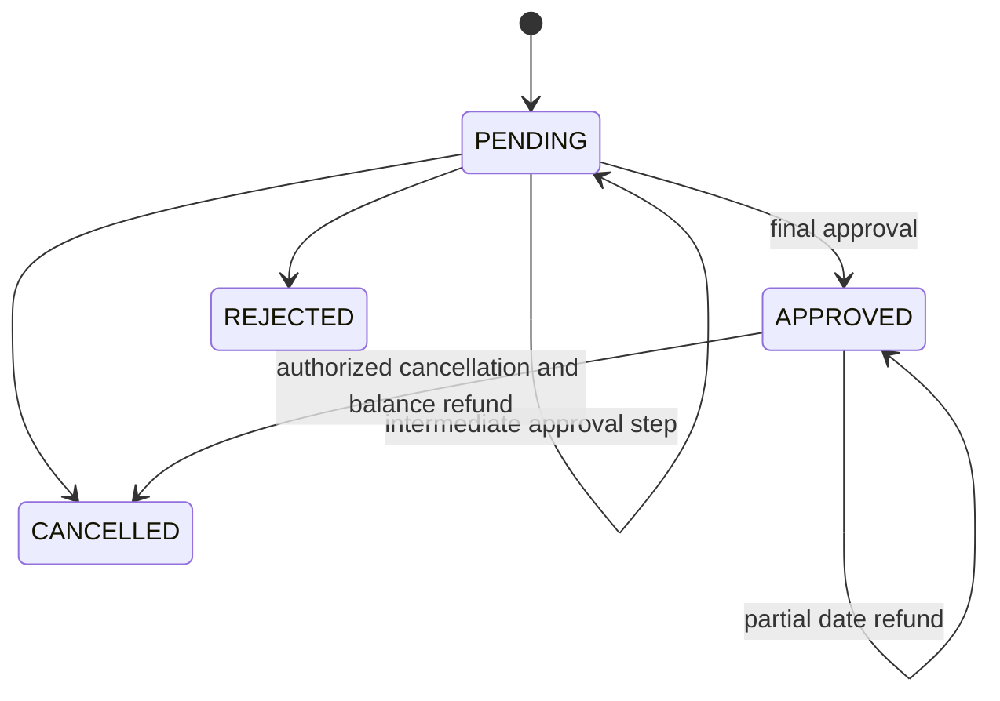
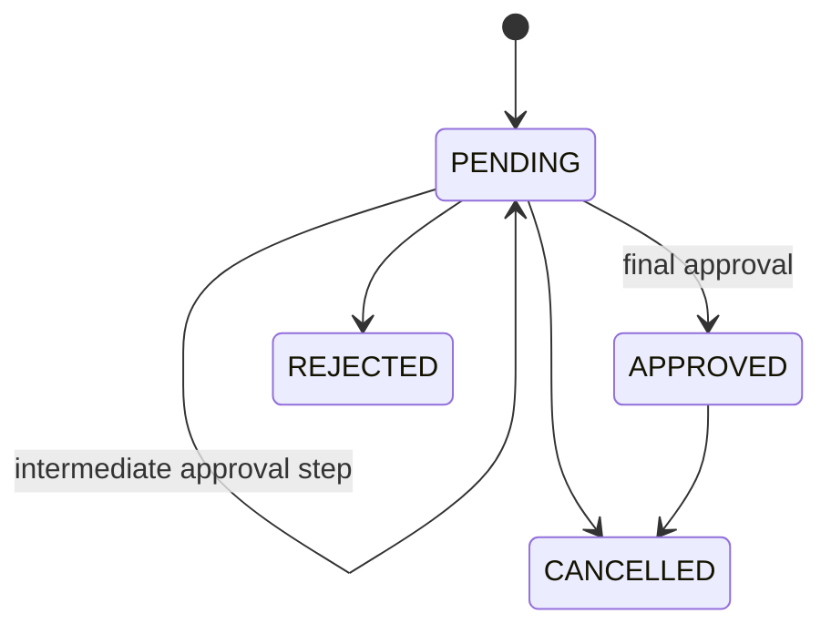
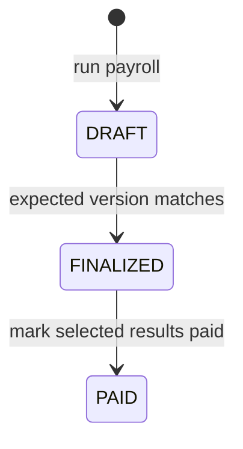

# HR Module Developer Guide

The HR module owns employee records and the operational lifecycle built on them: onboarding, schedules, calendars, attendance, leave, overtime, payroll, announcements, and HR dashboards.

Base path: `/api/hr`.

## Ownership Boundaries



| Module | Owns |
|---|---|
| `auth` | Accounts, credentials, sessions, roles, permissions, and access assignments. |
| `organization` | Departments, teams, and memberships. |
| `hr` | Employee profiles, HR schedules, attendance, requests, payroll, and announcements. |
| `integration` | External SQL attendance connectivity and polling. It calls `hr.public.importAttendancePunches()`. |
| `audit` | Immutable activity evidence written through `audit/public.js`. |

Do not recreate accounts, teams, departments, or audit storage inside HR. Cross-module calls must use the target module's `public.js`.

## Subdomains And Models

| Area | Main models | Responsibility |
|---|---|---|
| Employee | `HrEmployeeProfile` | Company profile, organization placement, personal data, employment status, and compensation data. |
| Scheduling | `HrWorkLocation`, `HrShift`, `HrShiftAssignment`, `HrCalendarOverride` | Effective work location, timezone, shift, and date-specific schedule exceptions. |
| Calendar | `HrHoliday`, `HrSaturdayRotation` | Holidays, substitute work days, and team Saturday staffing. |
| Attendance | `HrAttendanceDaily`, `HrAttendanceImportBatch` | One resolved daily record per employee and idempotent import batches. |
| Leave | `HrLeaveRequest`, `HrLeaveBalance` | Leave calculation, approval, balance consumption, refund, cancellation, and attendance projection. |
| Overtime | `HrOvertimeRequest` | Planned OT intervals, approval, overlap prevention, and rate-minute allocation. |
| Payroll | `HrPayrollRun`, `HrPayrollResult`, `HrPayrollAdjustment`, `HrPayrollEmailJob` | Immutable calculation snapshots, lifecycle transitions, adjustments, and queued payslip delivery. |
| Announcements | `HrAnnouncement` | Draft, scheduled, published, targeted, and reminder notifications. |

Repositories are the only HR layer that queries Mongoose models. Controllers validate HTTP input, services own business rules, and DTOs control every response shape.

## Staff Onboarding



`POST /api/hr/staff-provisioning` performs the account, access assignment, employee profile, annual leave balance, and audit writes in one MongoDB transaction. The employee logs in with work email or employee code.

New provisioned accounts have `mustChangePassword: true`; profiles have `isProfileUpdated: false`. The authentication setup guard allows only password change, personal-profile completion, `/api/auth/me`, and logout until both steps are complete.

Company-managed fields and personal self-service fields are separate:

- HR manages employee code, work email, organization placement, job data, employment status, contract data, and compensation.
- The employee updates only their own personal contact, emergency, identity, dependant, and bank details through `/employee-profiles/me/personal`.

See [STAFF_PROVISIONING_API.md](./STAFF_PROVISIONING_API.md) for request and response contracts.

## Sensitive Employee Data

Directory and cross-module reads must use DTOs or the whitelisted HR public port. The public profile contains only identifiers, employee code, display name, organization placement, status, and onboarding state.

Compensation and identity fields are not selected by default. Access to salary, allowances, bank account, identity card, tax id, and social insurance data requires the relevant compensation permission and a service-level scope check.

Do not put PII values in audit metadata, logs, notification payloads, or cross-module DTOs.

## Schedule Resolution

`scheduleResolver.resolveWorkContext({ profileId, workDateKey })` is the canonical schedule decision.

It requires:

1. a valid `YYYY-MM-DD` work date;
2. an active employee profile;
3. one active effective shift assignment;
4. an active shift and work location;
5. a valid IANA timezone and a shift no longer than 16 hours.

Calendar overrides are selected by specificity:

```text
PROFILE > TEAM > DEPARTMENT > WORK_LOCATION > GLOBAL
```

An override can make the date `HOLIDAY`, `REST_DAY`, or `WORKING_DAY`. Without an override, the shift's `workdays` decide whether the date is a working day.

Attendance, leave, and overtime persist schedule snapshots. Historical records therefore keep the timezone, planned instants, shift, location, organization placement, and calendar decision that applied when the record was created.

## Attendance

`HrAttendanceDaily` has a unique `(profileId, workDateKey)` record. Sources are:

- `SELF_SERVICE`: employee check-in/check-out;
- `SQL_ATTENDANCE`: normalized external punches;
- `LEAVE_RECONCILIATION`: approved leave projection;
- `MANAGED`: HR manual correction.

Resolution combines the schedule snapshot, calendar state, check-in/check-out, leave segments, and manual adjustment. Overnight shifts check the previous, current, and next work dates so an after-midnight punch remains attached to the correct shift.

External imports are idempotent by `sourceBatchId`. A completed batch returns as unchanged; a daily record already linked to the batch or manually edited is not overwritten. Imports store the earliest punch as check-in and the latest later punch as check-out.

Manual corrections append before/after evidence and preserve `isManualEdited`, preventing later imports from silently replacing the correction.

## Leave



Leave requests snapshot every effective working date. `FULL_DAY` occupies morning and afternoon; half-day requests occupy only their requested portion. Canonical conflict keys prevent overlapping active `PENDING` or `APPROVED` requests at database level.

Final approval consumes the leave balance and projects leave segments into attendance in the same controlled workflow. Cancellation removes only that request's projection; annual-leave cancellation or refund returns the matching balance units. Approval and retry paths are idempotent and verify authorization before returning an already-completed result.

## Overtime



OT uses absolute UTC half-open intervals `[plannedStartAt, plannedEndAt)`. Canonical epoch-minute conflict keys prevent overlapping active requests, including overnight requests. Approval stores total approved minutes and the rate allocation across weekday, weekend, holiday, and night buckets for payroll.

## Payroll



A payroll run is unique per month and year. Calculation creates immutable per-employee input and output snapshots containing work units, overtime, allowances, adjustments, insurance, tax, gross income, deductions, and net income.

Finalization uses optimistic version checking. A stale version or non-draft run is rejected. Payment updates the run/results through the payroll service and records the actor and timestamps.

Payslip email is queued through `HrPayrollEmailJob`; delivery runs in `src/modules/hr/workers/payrollEmail.worker.js`. Do not send payroll email synchronously from controllers.

## Announcements

Announcement states are `DRAFT`, `SCHEDULED`, `PUBLISHED`, and `ARCHIVED`.

- Scheduled announcements require a future `scheduledAt`.
- Targeting may be company-wide, by department, or by employee profile.
- Non-managers see only published announcements in their audience.
- Publication and reminder notification markers make worker retries safe.

Run the announcement publisher/notification worker with:

```bash
npm run worker:hr-announcements
```

## Permissions And Scope

| Area | Permissions |
|---|---|
| Employee | `HR_EMPLOYEES:READ`, `HR_EMPLOYEES:WRITE` |
| Compensation | `HR_COMPENSATION:READ`, `HR_COMPENSATION:WRITE` |
| Schedule | `HR_SCHEDULE:READ`, `HR_SCHEDULE:WRITE` |
| Calendar | `HR_CALENDAR:READ`, `HR_CALENDAR:WRITE` |
| Attendance | `HR_ATTENDANCE:READ`, `HR_ATTENDANCE:WRITE`, `HR_ATTENDANCE:MANAGE` |
| Leave | `HR_LEAVE:READ`, `HR_LEAVE:WRITE`, `HR_LEAVE:APPROVE` |
| Overtime | `HR_OVERTIME:READ`, `HR_OVERTIME:WRITE`, `HR_OVERTIME:APPROVE` |
| Payroll | `HR_PAYROLL:READ`, `HR_PAYROLL:WRITE`, `HR_PAYROLL:FINALIZE`, `HR_PAYROLL:PAY` |
| Announcements | `HR_ANNOUNCEMENTS:READ`, `HR_ANNOUNCEMENTS:WRITE` |
| Integration | `HR_INTEGRATIONS:MANAGE` |

Most HR routes use `authorizeAnyPermission` as a broad gate because access may come from a scoped assignment. Services must then enforce the exact `own`, `team`, or `department` scope against the loaded profile or snapshot.

Creating or editing global work locations and shifts requires global `HR_SCHEDULE:WRITE`. A team- or department-scoped grant is not enough for these shared master records.

Self-service routes resolve the authenticated account's profile; clients cannot submit another account id to turn a self-service operation into an administrative one.

## HTTP Endpoint Groups

| Prefix | Capability |
|---|---|
| `/employee-profiles`, `/staff-provisioning` | Employee directory, onboarding, and profile lifecycle. |
| `/work-locations`, `/shifts`, `/shift-assignments`, `/calendar-overrides` | Schedule master data and effective assignments. |
| `/holidays`, `/saturday-rotations` | Calendar policy. |
| `/attendance` | Attendance lists, monthly matrix, self check-in/out, and corrections. |
| `/leave-balances`, `/leave-requests` | Leave balances and request workflow. |
| `/overtime-requests` | OT request workflow. |
| `/payrolls`, `/payroll-adjustments` | Payroll calculation, results, lifecycle, adjustments, export, and email. |
| `/announcements` | Announcement publishing and audience reads. |
| `/dashboard` | HR summary read model. |

The current route source is authoritative for the individual endpoint list: `src/modules/hr/routes/index.js`.

## Public Port

`src/modules/hr/public.js` intentionally exposes a small, PII-safe contract:

- public profile lookup by account id or employee code;
- batch public profile lookup;
- permission-filtered assignable profiles;
- approved leave and overtime summaries;
- attendance summaries;
- attendance punch import;
- payroll calculation, finalization, and payment.

Add a public-port method only when another module has a real consumer. Do not export HR repositories, models, or internal services.

## Operations

Run the narrow HR tests:

```bash
npm test -- --runInBand src/test/hr
```

Audit deployment readiness:

```bash
npm run audit:hr:readiness
node src/modules/hr/scripts/auditHrTimeReadiness.js --timezone=Asia/Ho_Chi_Minh
```

Create required HR time indexes only after verifying the target database reported by the script:

```bash
node src/modules/hr/scripts/ensureHrTimeIndexes.js
```

Start background workers separately from the API process:

```bash
npm run worker:sql-attendance
npm run worker:hr-announcements
npm run worker:payroll-email
```

## Related Documents

- [Staff provisioning API](./STAFF_PROVISIONING_API.md)
- [HR core migration map](./hr-core-phase-1-migration-map.md)
- [HR time and attendance migration map](./hr-time-attendance-phase-2-migration-map.md)
- [Legacy parity matrix](./legacy-parity-matrix.md)
- [HR cutover runbook](./runbooks/hr-cutover.md)
- [HR rollback runbook](./runbooks/hr-rollback.md)
- [Shadow payroll runbook](./runbooks/shadow-payroll.md)
- [RBAC developer guide](../auth/RBAC_OVERVIEW.md)
