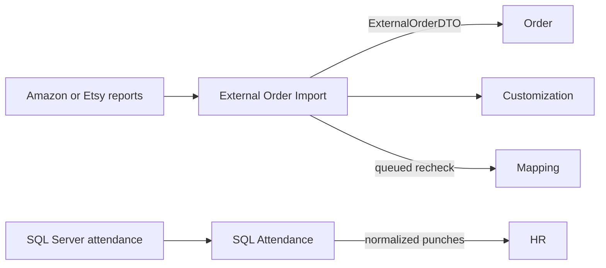

# Integration Module Developer Guide

The Integration module owns external-system adapters, source ingestion, durable synchronization state, and orchestration into domain public ports.

Current integration surfaces:

| Submodule | HTTP base path | Responsibility |
|---|---|---|
| `externalOrderImport` | `/api/integration/external-order-imports` | Marketplace report intake, normalization, import evidence, issues, retry, and post-import automation. |
| `sqlAttendance` | `/api/hr/integrations/sql-attendance` | Cursor-based SQL Server attendance ingestion into HR. |

`GET /api/integration/health` reports the top-level module health. SQL Attendance is mounted under the HR URL because it is an HR operator surface, but its external adapter and cursor state remain owned by Integration.

## Boundary



Integration may understand external file layouts, column names, cursors, credentials, transport failures, and source identifiers. It must not persist another module's aggregates directly.

- Orders are created only through `order.public.importExternalOrder()`.
- Customization payloads are created and processed through `customization/public.js`.
- Post-import mapping is requested through `mapping/public.js`.
- Attendance punches are imported through `hr.public.importAttendancePunches()`.

Do not move marketplace credentials, cursors, raw source rows, or sync state into Shop, Order, or HR domain models.

## External Order Import Records

| Record | Responsibility |
|---|---|
| `ExternalOrderImportJob` | One file-processing run, Shop/channel context, counters, lifecycle, and terminal error. |
| `ExternalOrderImportSourceFile` | File metadata and deterministic file hash. The current flow does not persist the uploaded binary here. |
| `ExternalOrderRawRecord` | One source row, stable row hash, normalization/import/post-import state, Order links, and retry lease. |
| `ExternalOrderImportIssue` | Actionable row/job exception with type, severity, status, error, and resolution metadata. |

Within a job, raw row identity is `(importJobId, rowNumber)`. Order idempotency is delegated to Order's external identity; Customization has its own `(orderItemId, rawCustomizationHash)` idempotency key.

The raw-record DTO excludes `rawRecord` and `rawRecordHash`. Source values such as long marketplace item ids remain strings to avoid numeric precision loss.

## Supported Order Sources

Current HTTP intake supports:

- Amazon order report: `.txt`, `.tsv`, or `.csv`;
- Etsy Shop Manager Sold Order Items: `.csv`.

Both are recorded with source `MANUAL_EXCEL` and source type `FILE`. `AMAZON_EXTENSION_REPORT` and `EXTENSION_REPORT` remain recognized contract values, but no extension-agent HTTP flow is implemented.

Uploads use in-memory Multer storage with a 10 MiB request limit. Multipart form-data is the production path; raw text, `fileContent`, and `fileBase64` are compatibility inputs for local tests.

`.xlsx` files are not supported.

## Import Pipeline

```text
upload
  -> create PARSING job and source-file metadata
  -> parse delimited rows
  -> persist every non-blank raw row
  -> validate required fields
  -> group valid rows by external order
  -> map each group to ExternalOrderDTO
  -> order.public.importExternalOrder()
  -> validate address
  -> create/process customization when present
  -> enqueue mapping recheck per imported item
  -> finalize job counters and status
```

The import is synchronous through Order creation. Post-import Mapping/Listing/PSD/Production work is asynchronous. Therefore `job.status=COMPLETED` means source rows reached Order without import issues; it does not mean downstream automation finished. Read `summary.postImport` for that state.

### Job lifecycle

```text
PENDING -> PARSING -> IMPORTING -> COMPLETED
                                -> PARTIAL_FAILED
          any job-level error  -> FAILED
PENDING / active              -> CANCELLED (reserved status)
```

The current upload service creates a job directly in `PARSING`; it does not expose cancel behavior.

- `COMPLETED`: all valid rows imported and no issue was created.
- `PARTIAL_FAILED`: a row failed or a non-blocking issue was created.
- `FAILED`: file/job processing aborted with a job-level error.

### Raw-record lifecycle

Normalization and import are tracked independently:

```text
normalizeStatus: PENDING -> NORMALIZED | FAILED | SKIPPED
importStatus:    PENDING -> IMPORTED   | FAILED | SKIPPED
```

Missing required fields fail normalization and create an issue. Rows grouped into a DTO share the resulting Order id; duplicate source rows for the same external item retain their individual raw-record links.

## Customization Handoff

After Order import, customized items are passed to Customization. The importer currently:

1. creates the hash-idempotent payload;
2. parses Amazon or Etsy-shaped raw customization;
3. transitions a successfully parsed item to `CUSTOMIZATION_PARSED` when allowed;
4. downloads supported source assets;
5. inspects and extracts Amazon ZIP content when a ZIP was downloaded;
6. records a `CUSTOMIZATION_MISMATCH` issue and marks review when ZIP identity conflicts with the imported Order/Item.

For scientific-notation corruption of a marketplace item id, a matching ZIP order id plus canonical integer item id can repair `OrderItem.externalItemId`. Other identity mismatches require review.

Customization failures do not roll back an already imported Order. They create `CUSTOMIZATION_CREATE_FAILED` issues and make the job `PARTIAL_FAILED`.

## Post-import Queue

Every imported item is offered to BullMQ queue `external-order-post-import` using deterministic job id:

```text
post-import:{importJobId}:{orderItemId}
```

Queue behavior:

- three attempts with exponential backoff starting at 30 seconds;
- worker concurrency `3`;
- each processor call claims raw records with a random lease token for five minutes;
- only the lease owner may finish those records;
- the worker calls `mapping.public.recheckFulfillmentPlan()`;
- an unexpected final-attempt failure creates `MAPPING_RECHECK_FAILED`.

Post-import states:

```text
PENDING -> QUEUED -> PROCESSING -> COMPLETED
                              -> FAILED
PENDING ----------------------> SKIPPED
```

A blocked fulfillment plan still counts as completed if Mapping returned normally. `FAILED` is reserved for unexpected processing failure.

When Redis is disabled or queue submission fails, the raw records are marked `FAILED` with `POST_IMPORT_QUEUE_UNAVAILABLE`; the Order import remains persisted. The API process starts the worker and recovery scheduler only when Redis is enabled.

The recovery scheduler runs at startup and every five minutes. It reprocesses stale queued/leased records in batches of 50. The explicit retry endpoint also:

- replays normalized rows whose import is `PENDING` or `FAILED`;
- skips completed post-import work;
- requeues `PENDING`/`FAILED` post-import records;
- requeues `QUEUED`/`PROCESSING` records only after ten minutes of staleness.

## Import Issues

Issue statuses are `OPEN`, `RESOLVED`, and `IGNORED`; severities are `INFO`, `WARNING`, `ERROR`, and `CRITICAL`.

Current issue types:

```text
NORMALIZE_FAILED
SHOP_RESOLVE_FAILED
ADDRESS_VALIDATION_FAILED
ORDER_IMPORT_FAILED
MAPPING_RECHECK_FAILED
CUSTOMIZATION_CREATE_FAILED
CUSTOMIZATION_MISMATCH
DUPLICATE_RECORD
MISSING_REQUIRED_FIELD
INVALID_FILE_FORMAT
UNSUPPORTED_FILE_TYPE
```

The global issue endpoint is an operator queue filtered to readable Shop job ids. Order readiness uses the public `listOpenIssuesForExternalItem()` query; open issues can therefore block fulfillment readiness.

There is currently no HTTP endpoint to resolve or ignore an issue. Do not document an issue workflow mutation until one exists.

## Order-import Authorization

Routes authenticate and require `ORDERS:WRITE` for upload/retry, or `ORDERS:READ`/`ORDERS:WRITE` for reads. Services then enforce the job or requested target's exact Shop scope.

- Global read/write permission can read all jobs and issues.
- Shop-scoped read or write can read that Shop's jobs.
- Writes require exact shop-scoped or global `ORDERS:WRITE`.
- A global issue list is restricted to authorized import job ids.
- No readable Shop returns an empty paginated issue result.

Never authorize a job solely from a client-provided `shopId`; load the job and check its stored Shop.

## SQL Attendance Sync

SQL Attendance is an Integration adapter, while HR owns employee matching, punch idempotency, daily attendance, and reconciliation.

Routes:

```text
POST /api/hr/integrations/sql-attendance/sync
GET  /api/hr/integrations/sql-attendance/status
```

Both require `HR_INTEGRATIONS:MANAGE` in the effective auth context. These endpoints do not resolve a resource scope, so do not grant that permission in an unrelated scope. Sync enqueues BullMQ job `sql-attendance`; the separately started worker runs at concurrency `1`:

```bash
npm run worker:sql-attendance
```

### Cursor contract

The SQL query is ordered by `(timestamp, stable source event id)` and resumes with:

```text
timestamp > lastSourceTimestamp
OR timestamp = lastSourceTimestamp AND sourceEventId > lastSourceEventId
```

`DB_ATTENDANCE_EVENT_ID_COLUMN` is required and must be a safe SQL identifier. Schema, table, timestamp, user, and event-id identifiers are validated before interpolation; cursor values and limit are bound parameters.

Rows normalize to `{ sourceEventId, employeeCode, occurredAt }`. When employee code is absent, the adapter derives `J{userId}`. Invalid rows are dropped before HR handoff.

The page receives a deterministic batch id from its ordered source identities. HR receives `sourceId=sourceEventId` for per-punch idempotency. The cursor advances only after HR reports zero failed punches; any failure marks sync state `FAILED` and keeps the previous cursor for safe replay.

Sync state is a singleton with statuses:

```text
IDLE | RUNNING | SUCCESS | FAILED
```

It stores the tuple cursor, last batch id/result, error message, and start/finish timestamps. An empty page records `SUCCESS` without moving the cursor.

## Public Ports

Other modules import `src/modules/integration/public.js`, which exposes two nested ports:

```js
const integrationPublic = require('../integration/public');

integrationPublic.externalOrderImport;
integrationPublic.sqlAttendance;
```

External Order Import exposes import commands, job read/retry, and the open-issue readiness query. SQL Attendance exposes enqueue/status, direct page sync for workers/tests, legacy-state migration, and its route contract.

Do not expose models or repositories to domain modules.

## Endpoint References

- [EXTERNAL_ORDER_IMPORT_API.md](./EXTERNAL_ORDER_IMPORT_API.md) contains upload, job, issue, raw-record, and retry payloads.
- [HR_MODULE_GUIDE.md](../hr/HR_MODULE_GUIDE.md) describes how imported punches feed HR attendance.

## Development Checklist

1. Keep external formats and cursors inside Integration.
2. Normalize into a target module's public DTO/command; never write its models.
3. Preserve raw evidence and string identifiers before normalization.
4. Make source replay idempotent at both batch and record levels.
5. Enforce stored Shop scope on every job read or mutation.
6. Keep async completion separate from synchronous import completion.
7. Use deterministic queue ids plus leases for retryable work.
8. Advance external cursors only after the entire page succeeds.
9. Keep credentials and connection strings out of models, DTOs, logs, and docs.
10. Run Integration tests and the architecture contract.

```bash
npm test -- --runInBand src/test/integration
npm run test:architecture -- --runInBand
```
