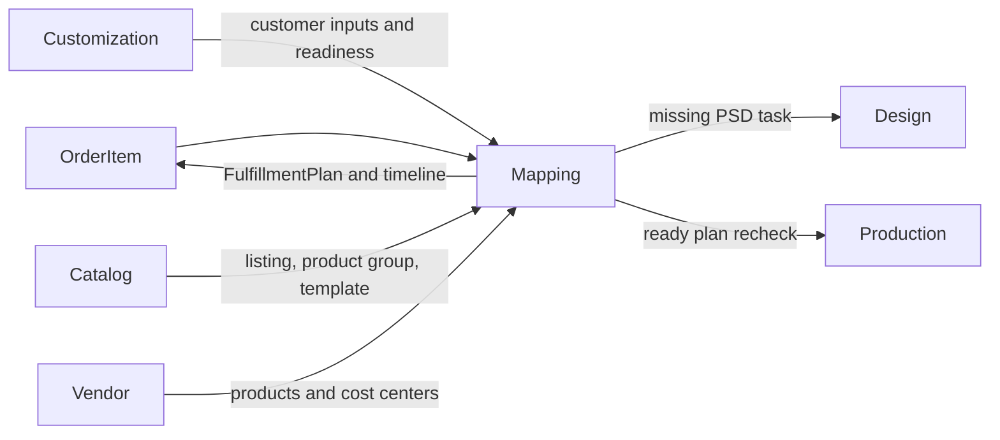

# Mapping Module Developer Guide

The Mapping module turns an imported `OrderItem` into a vendor-ready `FulfillmentPlan`. It owns SKU and customer-input normalization, product-type resolution, vendor routing, candidate ranking, manual selection, and the evidence snapshot used by downstream workflow.

Base path: `/api/mapping`.

## Boundary



Mapping does not own source orders, customization payloads, catalog records, vendor master data, design reviews, or production tasks. It accesses those capabilities only through each module's `public.js`.

## Owned Data

| Model | Responsibility |
|---|---|
| `MappingSkuNormalizeRule` | Remove or replace known SKU segments before lookup and parsing. |
| `MappingSkuConfigRule` | Map a config code and product-type signal to a Product Type Group and optional Internal Template. |
| `MappingNormalizationRule` | Convert marketplace labels or values into semantic inputs such as size, color, and product type. |
| `VendorRoutingRule` | Prefer a Vendor for an exact or broader fulfillment context. |
| `MappingRuleAudit` | Append-only `CREATED`, `UPDATED`, and `STATUS_CHANGED` rule evidence. |
| `FulfillmentPlan` | One persisted vendor selection and evidence snapshot per OrderItem. |

Rules use `ACTIVE` or `INACTIVE`; updates do not delete history. A rule's `shopId` is immutable after creation.

## Scope And Precedence

Rules may be global or narrowed by fields supported by their model. Common scope fields are Shop, sales channel, marketplace, and Product Type Group; routing can additionally use ASIN, config code, normalized size, and normalized color.

For matching active rules:

1. the more specific matching scope wins;
2. lower numeric `priority` wins;
3. stable creation/id ordering breaks any remaining routing tie.

SKU config resolution also uses normalized customer product-type aliases. If equally specific, equally prioritized rules point to different Product Type Group/Template targets, the result is ambiguous and mapping adds `SKU_CONFIG_AMBIGUOUS`.

## Resolution Pipeline

`previewFulfillmentPlan()` is the canonical read-only evaluation path:

1. Load the OrderItem and enforce exact Shop access.
2. Apply active SKU normalization rules and produce the canonical SKU.
3. Ask Catalog for an active, approved Listing by ASIN, canonical SKU, then original SKU.
4. Parse the canonical SKU and load matching SKU config rules.
5. Read normalized customer inputs from Customization.
6. Select the Product Type Group and optional Internal Template.
7. Check required template inputs and customization readiness.
8. Load active Vendor Products and Cost Centers for the selected product group.
9. Apply Vendor Routing rules, score candidates, calculate cost estimates, and sort them.
10. Return blockers and, only for one unambiguous high-confidence candidate, `autoMatch`.

Normalized inputs are built in this order: explicit normalization rule, SKU-config key buckets, Internal Template metadata, then label heuristics. The result keeps one value per semantic role; a more specific explicit rule wins.

Preview never writes a Listing or FulfillmentPlan. `resolve` and `recheck` run the same pipeline with controlled missing-Listing creation enabled once a Product Type Group is resolved unambiguously.

## Candidate Ranking And Auto Match

Cost Centers are sorted by:

1. match tier;
2. Vendor Routing specificity;
3. routing priority;
4. match score;
5. base cost;
6. stable id.

Routing preference is therefore a tie-breaker, not permission to select an incompatible Cost Center. Auto-match requires the top candidate to have `HIGH` confidence and no other candidate tied on all decisive ranking and cost fields.

Manual candidate search accepts filters such as Vendor, Vendor Product, Product Type Group, size, color, SKU, and LNG code. Manual size/color override normalized signals for that search only.

## Readiness And Blockers

The main blocking reasons are:

```text
ORDER_ITEM_NOT_FOUND
LISTING_NOT_FOUND
SKU_CONFIG_AMBIGUOUS
INTERNAL_TEMPLATE_NOT_FOUND
CUSTOMIZATION_NOT_READY
SELECTED_OPTION_OUT_OF_STOCK
TEMPLATE_REQUIRED_INPUT_MISSING
NO_VENDOR_PRODUCT_CANDIDATE
NO_VENDOR_COST_CENTER_CANDIDATE
SELECTED_VENDOR_PRODUCT_INVALID
SELECTED_VENDOR_COST_CENTER_INVALID
PLAN_ALREADY_RESOLVED
```

`ready=true` means no blocker exists. One deliberate exception applies to persistence: a valid vendor selection may be stored while `CUSTOMIZATION_NOT_READY` is the only blocker. The plan is still `READY`, retains that blocker in its snapshot/checks, does not mark the OrderItem fulfillment-ready yet, and lets Production create or recheck its task with the remaining customization gate.

## Persisted Plan Semantics

`resolve` persists an `AUTO` plan only when preview returns a safe `autoMatch`. Otherwise it returns the preview and does not persist a blocked plan.

`select` validates that:

- the Vendor Product exists and belongs to the resolved Product Type Group;
- the Cost Center is active and belongs to both that Vendor Product and Vendor;
- no blocker exists other than the customization-only exception.

There is a unique plan per OrderItem. Repeating the same confirmed selection is idempotent. A different automatic selection cannot replace a ready/confirmed plan. A manual selection may replace an existing `READY` choice after Production prepares the item for a mapping override; a `CONFIRMED` plan remains protected. `/confirm` is currently only a compatibility alias of `/select` and does not change the status to `CONFIRMED`.

The stored snapshot freezes OrderItem, Listing, Template, Vendor Product, Cost Center, and cost-estimate evidence so later master-data edits do not rewrite the resolution record.

## Downstream Effects

After a selection is stored, Mapping:

- refreshes Order cost-center and PSD aggregate statuses;
- appends `PLAN_READY` or `MANUAL_VENDOR_MATCHED` to the Order timeline;
- marks the OrderItem fulfillment-ready only when preview has no blockers;
- asks Production to create or recheck its task.

During write-enabled recheck, Mapping may also link a newly created Listing to the OrderItem, import a missing Listing preview from Customization, and request a PSD Design task when Catalog reports missing PSD readiness. Best-effort Design/Production follow-ups are logged rather than rolling back a valid mapping write.

## Authorization

| Surface | Authorization |
|---|---|
| Preview, summary, workbench, unmatched queue, candidate search, plan read | Global or exact shop-scoped `MAPPING:READ` |
| Resolve, recheck, select, batch recheck | Global or exact shop-scoped `MAPPING:WRITE` |
| Shop-scoped rule read/write | Matching Shop scope or global permission |
| Global rule read/write | Global `MAPPING:READ` / `MAPPING:WRITE` |

`authorable-shops` returns only Shops on which the caller can author rules. List services constrain results to readable Shops; an explicitly requested inaccessible Shop is rejected or produces an empty scoped result according to the surface.

## Rule Operations

All four rule families support list, create, detail, and patch. `semantic-rules` and `value-aliases` are operator-focused aliases backed by `MappingNormalizationRule`.

Additional tools:

- `rule-preview` evaluates an unsaved rule against samples without writing;
- `rule-conflicts` reports exact-scope conflicts as errors and broader-scope overlaps as warnings;
- `/:ruleType/:id/history` returns newest-first audit events;
- Vendor Routing reorder updates priorities within one authorized scope;
- the config workbench combines rule pages with recent unmatched samples and recommended fix types.

Supported history rule types are `normalization`, `semanticRules`, `valueAliases`, `vendorRouting`, `skuConfig`, and `skuNormalize`.

## Public Port

`src/modules/mapping/public.js` exposes authorization-aware capabilities for:

- preview, resolve, recheck, manual select, and compatibility confirm;
- OrderItem plan lookup and batch plan lookup;
- Vendor candidate search;
- rule preview, conflict detection, history, and authorable Shops.

Other modules must import this port instead of Mapping services, repositories, or models.

## Endpoint Groups

| Group | Paths |
|---|---|
| Operational reads | `GET /summary`, `/config-workbench`, `/order-items/unmatched`, `/order-items/:id/plan` |
| Item resolution | `POST /order-items/:id/preview`, `/resolve`, `/recheck`, `/select`, `/confirm` |
| Candidate search | `POST /order-items/:id/vendor-candidates/search` |
| Batch operation | `POST /recheck-unmatched` |
| Rule administration | CRUD-like routes for normalization, semantic/value aliases, SKU config, SKU normalize, and Vendor Routing rules |
| Rule safety/audit | `GET /authorable-shops`, `POST /rule-preview`, `POST /rule-conflicts`, `GET /:ruleType/:id/history` |

Request and response examples are in [MAPPING_API.md](./MAPPING_API.md).

## Change Checklist

- Keep cross-module imports on `public.js`.
- Keep preview read-only; write only in explicit write flows.
- Preserve Shop-scoped authorization for both records and OrderItems.
- Treat money as non-negative integer minor units.
- Preserve deterministic specificity/priority ordering and ambiguity detection.
- Do not create Production handoff before mapping, template, vendor, and customization gates are represented.
- Update the plan snapshot and timeline semantics together when selection behavior changes.
- Run `npm test -- --runInBand src/test/mapping` and `npm run test:architecture -- --runInBand`.
