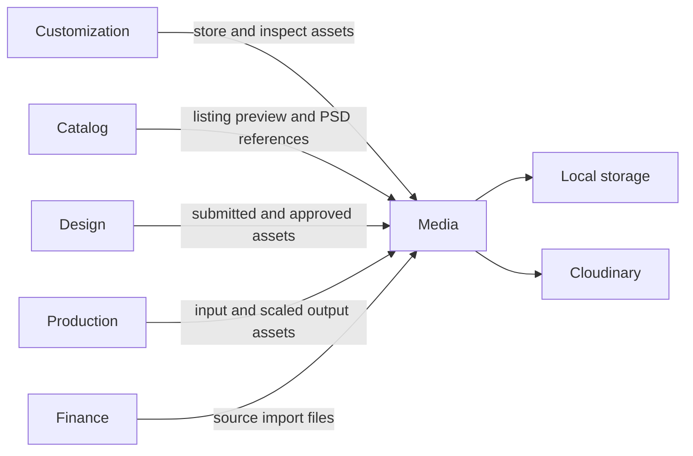

# Media Module Developer Guide

The Media module is the shared binary-storage boundary. It stores file bytes, integrity metadata, provider references, and safe read access while feature modules keep only `mediaAssetId` references.

Base path: `/api/media`.

## Boundary



Media owns binary persistence and the `MediaAsset` record. It does not own:

- OrderItem, Listing, Design Task, Production Task, or import-batch relationships;
- domain-specific attachment status or approval workflow;
- Shop-level authorization for the entity that references an asset;
- remote-source fetching policy used by Customization or Catalog.

Feature modules must import `src/modules/media/public.js` and store Media ids rather than filesystem paths, provider ids, or file buffers.

## MediaAsset Record

| Field group | Fields |
|---|---|
| Original file | `originalFilename`, `mimeType`, `size`, `sha256` |
| Storage | `storageFilename`, `relativeStoragePath`, `provider` |
| Cloud provider | `providerAssetId`, `resourceType`, `secureUrl` |
| Source provenance | `sourceUrlRedacted`, `sourceUrlHash`, `metadata` |
| Discard tombstone | `discardedAt`, `discardReason` |

`sha256` is calculated while streaming and indexed with `size`, but the current service does not deduplicate uploads. Every successful upload creates a new record and storage object.

The HTTP DTO deliberately omits `storageFilename`, `relativeStoragePath`, `providerAssetId`, source URL fields, arbitrary metadata, and discard fields. It returns id, original filename, MIME type, size, hash, provider, resource type, optional secure URL, and creation time.

## Storage Providers

`MEDIA_STORAGE_PROVIDER` selects the provider:

```text
local       default in service code
cloudinary  configured default in .env.example
```

### Local

The root is `MEDIA_STORAGE_ROOT`, defaulting to `<process.cwd()>/storage/media`.

Upload flow:

1. sanitize the original filename and keep only a safe extension;
2. stream to a random `.part` file under `<root>/tmp`;
3. enforce `maxBytes` while calculating SHA-256;
4. rename to `<sha256>-<uuid>.<ext>`;
5. create the Mongo record;
6. remove the partial/final file when streaming or Mongo persistence fails.

All resolved local paths are checked with `path.relative()` before use. Escapes outside `MEDIA_STORAGE_ROOT`, missing files, non-files, and stored-size mismatches are rejected.

### Cloudinary

Required configuration:

```text
CLOUDINARY_CLOUD_NAME
CLOUDINARY_API_KEY
CLOUDINARY_API_SECRET
```

`CLOUDINARY_FOLDER` defaults to `lng-system/media`. Images use Cloudinary resource type `image`, videos use `video`, and other MIME types use `raw`.

Cloudinary reads are downloaded over HTTPS into a temporary local file for the callback lifetime, then removed even when the callback fails. A local record with a missing local file can use the same fallback when it has `secureUrl`.

Current failure semantics are not transactional across Mongo and Cloudinary: an upload succeeds at Cloudinary before the Mongo record is created, and the service does not currently remove that remote object if Mongo creation fails.

## HTTP Upload

`POST /assets` uses multipart field `file` and requires `MEDIA:WRITE`.

The route first writes to a random OS temporary file, then streams it into the configured provider, and removes the temporary upload in `finally`.

Default HTTP limit:

```text
MEDIA_UPLOAD_MAX_BYTES=209715200  # 200 MiB
```

Allowed combinations:

- `.png`, `.jpg`, `.jpeg`, `.webp`, `.gif` with an `image/*` MIME type;
- `.psd`, `.pdf`, `.zip`, `.rar` with one of the accepted document/archive MIME types, including `application/octet-stream`.

The controller checks extension and declared MIME type. It does not inspect file magic; domain workflows such as Customization ZIP inspection perform their own deeper validation.

Internal `storeAsset()` defaults to 10 MiB unless its caller supplies `maxBytes`. Callers downloading or extracting external content must pass their own domain limit rather than assuming the HTTP upload limit.

## Read And Download

`GET /assets/:assetId` returns metadata. `GET /assets/:assetId/download` streams the binary through the backend with `Content-Type`, optional `Content-Length`, and attachment disposition.

Consumers should use the backend download route instead of persisting or constructing provider paths. It works for both providers and keeps local paths private.

`withAssetLocalReadFile(assetId, callback)` is the preferred internal read primitive. The path is valid only inside the callback because remote assets are materialized temporarily and cleaned immediately afterward. `readAssetBuffer()` exists for callers that genuinely need the whole asset in memory; use the callback/stream path for large files.

## Discard Lifecycle

There is no public HTTP delete endpoint. `discardUnattachedAsset()` is an internal compensation operation for a newly uploaded object that lost a compare-and-set race or failed to attach.

It atomically marks the record discarded only when all expected metadata matches:

```text
metadata.source
metadata.taskId
metadata.fileCheckId
metadata.uploadedBy
discardedAt=null
```

After the guarded tombstone succeeds, it removes the local file or calls Cloudinary destroy with the recorded provider id/resource type. A mismatch returns `MEDIA_ASSET_DISCARD_NOT_ALLOWED` and does not touch storage.

Discard is not a general garbage collector. The Mongo record remains as evidence. Current `getAsset()`, batch reads, filename search, and existence assertions do not exclude tombstoned records; physical download normally fails after successful storage deletion. If product behavior needs hidden/deleted assets, add that contract explicitly rather than inferring it from `discardedAt`.

For Cloudinary, tombstoning happens before remote deletion. A provider deletion failure leaves the record marked discarded and requires operational cleanup/retry.

## Authorization

| Endpoint | Permission |
|---|---|
| `POST /assets` | `MEDIA:WRITE` |
| `GET /assets/:assetId` | `MEDIA:READ` |
| `GET /assets/:assetId/download` | `MEDIA:READ` |

These are global permission checks through `authorizeAnyPermission()`. `MediaAsset` has no `shopId`, owner id, attachment ACL, or scoped authorization. A caller with `MEDIA:READ` can request any known asset id.

Feature modules remain responsible for authorizing their own Shop/domain resource before revealing a Media download link. Do not treat possession of an asset id as authorization.

## Public Port

`src/modules/media/public.js` exposes:

| Capability | Functions |
|---|---|
| Store/config | `storeAsset`, `getStorageProvider` |
| Metadata | `getAsset`, `getAssetsByIds`, `assertMediaAssetExists` |
| Search | `findAssetIdsByOriginalFilename` |
| Read bytes | `withAssetLocalReadFile`, `readAssetBuffer` |
| Compensation | `discardUnattachedAsset` |

`getAssetsByIds()` deduplicates requested ids. Filename search is a case-insensitive prefix query capped at 5,000 ids; it is a discovery helper, not an ownership or exact-identity check.

## Endpoint Summary

| Method | Path | Purpose |
|---|---|---|
| `GET` | `/health` | Unauthenticated module health. |
| `POST` | `/assets` | Upload one accepted file. |
| `GET` | `/assets/:assetId` | Read public asset metadata. |
| `GET` | `/assets/:assetId/download` | Stream the stored binary. |

Request and response examples are in [MEDIA_API.md](./MEDIA_API.md).

## Change Checklist

- Keep storage/provider details behind the Media public port.
- Stream large files; do not replace the pipeline with whole-file buffers.
- Preserve SHA-256, byte-limit, temporary-file cleanup, and root-containment checks.
- Keep source URLs redacted and avoid returning internal paths or arbitrary metadata.
- Validate both extension and MIME at the HTTP trust boundary.
- Authorize the owning domain object before exposing its asset link.
- Use guarded discard only for unattached uploads.
- Run `npm test -- --runInBand tests/media` and `npm run test:architecture -- --runInBand`.
