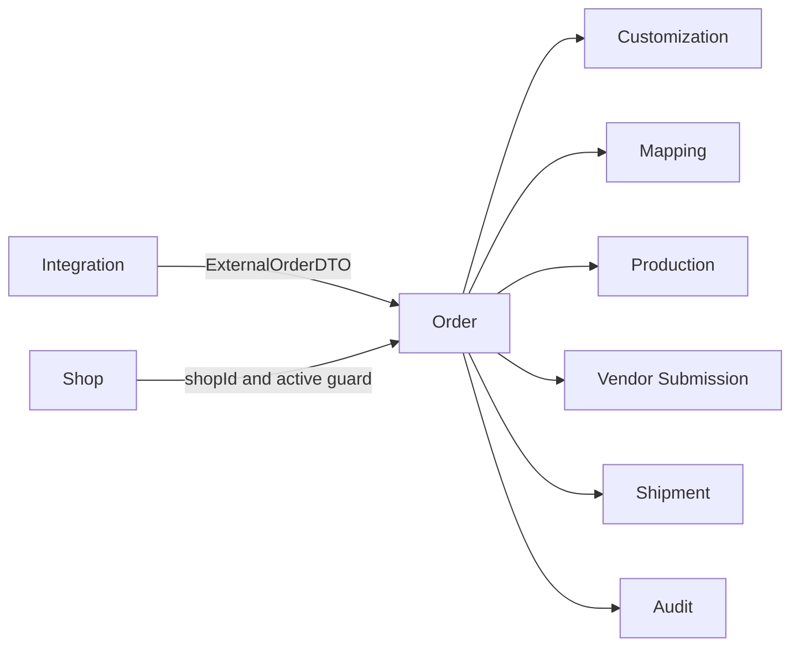

# Order Module Developer Guide

The Order module owns normalized customer orders, order-item lifecycle, operational cases, readiness decisions, and the order timeline.

Base path: `/api/orders`.

## Boundary



Order does not parse source files, deeply parse customization payloads, own fulfillment plans, create production tasks, submit vendor orders, or own shipment tracking. Those responsibilities remain in their modules.

Cross-module callers must use `src/modules/order/public.js`; they must not import Order models, repositories, or services directly.

## Aggregates

| Record | Responsibility |
|---|---|
| `Order` | Shop-scoped normalized order header, buyer and shipping snapshots, aggregate statuses, import identity, assignment, and replacement lineage. |
| `OrderItem` | Sellable line, quantity, minor-unit price fields, catalog identity, customization summary, lifecycle status, and replacement lineage. |
| `OrderCase` | First-class operational exception with type, severity, resolution state, and embedded comments. |
| `OrderTimeline` | Append-only, user-facing lifecycle history for an order or item. |

Stable external identities are:

```text
Order:     salesChannelCode + marketplaceCode + externalOrderId
OrderItem: orderId + externalItemId
```

`shopId` remains the internal ownership and authorization boundary. External seller, marketplace, and channel identifiers must not replace it.

Money on `OrderItem.price` is stored as integer minor units with a currency code. Do not introduce floating-point major-unit calculations in this module.

## Import Contract

Order import starts outside this module. Integration parses an approved source, normalizes each record to `ExternalOrderDTO`, then calls:

```js
const orderPublic = require('../../order/public');

await orderPublic.importExternalOrder(externalOrderDto);
```

Supported import sources are:

- `AMAZON_EXTENSION_REPORT`
- `MANUAL_EXCEL`

Do not add Amazon SP-API concepts or let Integration create `Order` or `OrderItem` documents directly.

`importExternalOrder()`:

1. validates the normalized DTO;
2. asserts that the target Shop is active;
3. upserts the Order by external identity;
4. upserts each item by `(orderId, externalItemId)`;
5. recovers duplicate-key races by reading the winning record;
6. rejects an existing external order identity assigned to a different Shop;
7. appends import or re-import timeline evidence;
8. refreshes aggregate cost-center and PSD readiness statuses.

Customization content is handed to `customization.public.createPendingPayload()` by the import pipeline. Order keeps only the summary required for routing and read models.

## Lifecycle Ownership

`OrderItem.status` is the operational source of truth. Only the transition service exposed through `order/public.js` may change it. Mapping, Production, Vendor Submission, Shipment, imports, scripts, and backfills must request a transition instead of updating the repository directly.

Main path:

```text
NEW
  -> CUSTOMIZATION_PENDING / MAPPING_PENDING
  -> CUSTOMIZATION_PARSED / FULFILLMENT_PLANNING
  -> FULFILLMENT_READY
  -> NEED_PRODUCTION / READY_TO_SEND_VENDOR
  -> IN_PRODUCTION
  -> READY_TO_SEND_VENDOR
  -> SENT_TO_VENDOR
  -> TRACKING_PENDING
  -> SHIPPED
```

`QC_REJECTED` can return to `IN_PRODUCTION` or `NEED_PRODUCTION`. Allowed operational states may stop at `CANCELLED` or `FAILED`; same-state transitions are idempotent. The complete transition matrix is maintained in [STATE_MACHINES.md](../architecture/STATE_MACHINES.md).

`Order.status` is derived from its items:

| Item aggregate | Order status |
|---|---|
| All `SHIPPED` | `SHIPPED` |
| Some `SHIPPED` | `PARTIALLY_SHIPPED` |
| Any active workflow state | `PROCESSING` |
| All `CANCELLED`, all `REFUNDED`, or all `FAILED` | Matching terminal status |
| Otherwise | `IMPORTED` |

Delivery is shipment evidence, not an item status. Items stay `SHIPPED`; Shipment calls `markOrderDelivered()` when every item shipment is delivered, which sets `Order.deliveredAt`.

## Fulfillment Readiness

`GET /api/orders/items/:orderItemId/readiness` evaluates the current item without mutating it. `POST .../mark-fulfillment-ready` changes the item to `FULFILLMENT_READY` only when every gate passes.

| Gate | Ready condition |
|---|---|
| Address | Order address is `VALID` or `OVERRIDDEN`. |
| Customization | Required customization is ready; non-customized items pass. |
| Mapping | Fulfillment plan is `READY` or `CONFIRMED`. |
| Import issues | No open Integration issue blocks the external item. |
| Item status | Item is not `CANCELLED`, `REFUNDED`, `FAILED`, or `SHIPPED`. |

A blocked write returns `409 CONFLICT_ERROR` with the full checklist and stable blocking reasons. A successful write changes item and parent state, timeline, and audit evidence in one order-operation transaction.

## Workbench And Read Models

`GET /api/orders/workbench` is the operator-facing aggregation surface. It enriches normalized order items with the latest available context from Customization, Mapping, Catalog, Production, Shipment, Shop, seller profile, and open Order Case.

The workflow projection maps each item to a stage, owner, blockers, and next actions. Current owners are:

```text
CS | DESIGN | MAPPING | OPERATIONS | SCALE | VENDOR | SHIPPING | SYSTEM
```

This projection is a read model. It must not become a second lifecycle state machine or write status into downstream aggregates.

`GET /api/orders/:orderId/expanded` serves a single enriched order. Normal list and summary endpoints use Order-owned repository projections and scope filters; do not add cross-module joins to controllers.

## Authorization

Routes authenticate first and require either `ORDERS:READ` or `ORDERS:WRITE` for reads, and `ORDERS:WRITE` for mutations. Services then enforce the exact target Shop:

- global `ORDERS:READ` or `ORDERS:WRITE` can read all Shops;
- exact shop-scoped `ORDERS:READ` or `ORDERS:WRITE` can read that Shop;
- writes require global or exact shop-scoped `ORDERS:WRITE`;
- lists restrict repository queries to readable Shop ids and return an empty page when none exist.

The route check alone is not sufficient because it cannot know the target resource's `shopId`. Always load the record and call the Order access service before returning or mutating it.

## Operator Mutations

Order owns controlled changes to shipping address, buyer snapshot, shipping service, assigned staff, CS notes, address validation, item cancellation, and replacement creation.

Address validation statuses are:

```text
NOT_CHECKED | VALID | INVALID | WARNING | OVERRIDDEN
```

Changing the address resets or updates its validation evidence through the address service; callers must not patch the model directly.

Cancellation is idempotent when the item is already `CANCELLED`. A vendor submission in `SUBMITTED` state blocks cancellation with `409 CONFLICT_ERROR`. Otherwise cancellation uses the transition validator and records timeline plus audit evidence transactionally.

A replacement creates a new internal Order and one new item:

- external ids receive the next `-R{sequence}` suffix, up to 100 attempts;
- replacement price fields are zero in the original currency;
- lineage and reason are stored on the new Order and item;
- the latest customization payload is cloned;
- Mapping is rechecked on a best-effort basis;
- cost-center and PSD statuses are refreshed;
- timeline and audit evidence are recorded.

Replacement creation does not modify or cancel the original item automatically.

## Cases, Timeline, And Audit

Order Cases are shop-scoped operational exceptions. A case can optionally target one item, but that item must belong to the case Order.

```text
OPEN -> RESOLVED
OPEN -> CANCELLED
```

Creating a case sets `Order.caseStatus=OPEN`. Resolving or cancelling it recomputes the aggregate: the Order remains `OPEN` while any open case exists, otherwise it becomes `NONE`. Status changes use expected-state writes so concurrent operators cannot resolve or cancel the same case twice. Comments, case transitions, and case mutations are recorded with the same order operation.

Timeline and Audit serve different consumers:

- `OrderTimeline` is append-only operational history returned by Order APIs. `idempotencyKey` can suppress duplicate integration/system events.
- Audit is immutable compliance evidence with actor, source, request context, changed fields, and metadata.

New mutations should normally write both. Use `withOrderOperation()` when the domain mutation and audit record must commit together. Existing legacy paths that cannot share a Mongo session keep audit best-effort and log a warning if it fails.

## Public Port

`src/modules/order/public.js` exposes the supported cross-module surface in these groups:

| Group | Capabilities |
|---|---|
| Import and lookup | Import normalized orders; find orders/items and finance identities; list items. |
| Reporting | Buyer, channel, listing-sales, and item summaries. |
| Lifecycle | Transition item status and mark an order delivered. |
| Identity enrichment | Update item external item id, ASIN, and listing id. |
| Timeline | Append once or normally; list by order or item. |
| Readiness | Validate/update address, mark fulfillment ready, refresh cost-center and PSD status. |
| Workflow | Derive the operator projection and expose address-validation constants. |

Do not expand the public port merely to avoid placing orchestration in the owning module. Add only a stable capability required by a real cross-module caller.

## Endpoint Groups

| Group | Paths |
|---|---|
| Queue and summaries | `GET /`, `/summary`, `/workbench`, `/customer-exceptions` |
| Detail | `GET /:orderId`, `/:orderId/expanded`, `/:orderId/items`, `/items/:orderItemId` |
| Readiness and workflow | Item readiness, mark-ready, and recheck endpoints |
| Operator edits | Shipping address, buyer, shipping service, assignment, and CS note endpoints |
| Exceptions | Case list/create/detail/update/resolve/cancel/comment endpoints |
| Recovery | Item cancel and replacement endpoints |
| Evidence | Order and item timeline endpoints |

See [ORDER_API.md](./ORDER_API.md) for parameters, payloads, response examples, and Postman usage.

## Development Checklist

When changing Order behavior:

1. Preserve `shopId` and enforce exact shop scope in the service.
2. Keep external identities idempotent and reject cross-Shop collisions.
3. Route every item status change through `order/public.js`.
4. Keep parent Order status derived from item states.
5. Use public ports for all cross-module reads and commands.
6. Return DTOs; keep Mongoose queries in repositories and use `.lean()` for reads.
7. Record lifecycle timeline and compliance audit evidence for mutations.
8. Update [STATE_MACHINES.md](../architecture/STATE_MACHINES.md) when transition rules change.
9. Run Order tests and the architecture contract.

Useful verification:

```bash
npm test -- --runInBand src/test/order
npm run test:architecture -- --runInBand
```
