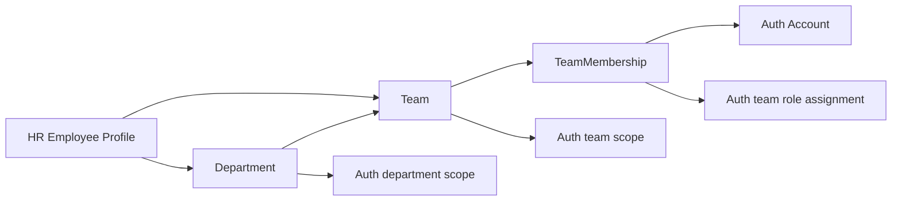

# Organization Module Developer Guide

The Organization module owns the company's department and team hierarchy plus each account's active team membership. Auth consumes those records as RBAC scopes; HR references them as employee placement.

Base path: `/api/organization`.

## Ownership



| Module | Responsibility |
|---|---|
| `organization` | Department, team, membership, leader/member classification. |
| `auth` | Account, role, permission, scope registry, and access assignment. |
| `hr` | Employee profile and its current `departmentId`/`teamId` placement. |

Organization does not store passwords or permission lists. Auth does not store department/team business data. HR does not become the source of team membership.

## Data Model

### Department

`Department` contains a unique uppercase `code`, display `name`, and `active`/`inactive` status.

### Team

`Team` belongs to one department and contains a unique uppercase `code`, display `name`, and status. Creating a team requires an active department.

### Team membership

`TeamMembership` connects one Auth account to one team as either:

- `leader`;
- `member`.

A unique partial index on `accountId` allows only one active team membership per account. Historical inactive memberships remain available instead of being hard deleted.

An Auth account may have a membership without an HR employee profile. Current member DTOs are therefore account-based: `accountId`, email, member type, roles, and permissions. Profile fields are currently returned as `null`.

## Scope Registry Synchronization

Creating or updating a department/team also creates or updates its Auth `ScopeRegistry` entry:

```text
Department._id -> scopeType=department, scopeId=Department._id
Team._id       -> scopeType=team,       scopeId=Team._id
```

The Organization write and Auth scope synchronization run in one MongoDB transaction. If scope synchronization fails, the department/team mutation is rolled back.

Organization is the source of scope name and status. Do not manually create a second Auth scope for the same resource.

## Membership And RBAC Synchronization

```mermaid
flowchart TD
  Request[Add or update membership] --> Existing{Active membership?}
  Existing -->|same team| Upsert[Update member type]
  Existing -->|different team| Old[Deactivate old membership and old team roles]
  Existing -->|none| Upsert
  Old --> Upsert
  Upsert --> Type{member type}
  Type -->|leader| Leader[Ensure team LEADER assignment; deactivate team USER]
  Type -->|member| Member[Ensure team USER assignment; deactivate team LEADER]
```



The membership and Auth assignment changes run in one transaction.

- Moving an account automatically deactivates its previous active membership and old team-scoped `LEADER`/`USER` assignments.
- Promoting to `leader` ensures a team-scoped `LEADER` assignment and deactivates the team-scoped `USER` assignment.
- Demoting to `member` ensures a team-scoped `USER` assignment and deactivates the team-scoped `LEADER` assignment.
- Removing a membership soft-deactivates it and deactivates both team role assignments.
- Auth handles permission-cache invalidation and access-assignment audit events.

Do not update `TeamMembership` directly when the change should also modify authorization.

## Authorization Rules

Route middleware provides a broad permission gate; the Organization service applies exact department/team scope filtering.

### Reads

Global `AUTH:READ`, `TEAMS:READ`, or `TEAMS:WRITE` grants unrestricted organization reads.

Without a global grant:

- list endpoints accept matching scoped `AUTH:READ`, `TEAMS:READ`, or `TEAMS:WRITE` and filter to those department/team ids;
- department/team details and member lists require matching scoped `TEAMS:READ` or `TEAMS:WRITE`;
- team lists union the allowed department and team scopes;
- team details and member lists accept either the exact team scope or its department scope.

List filtering happens in repository queries. Out-of-scope rows are not loaded and removed afterward.

### Department and team master writes

Creating or editing departments and teams requires global `AUTH:WRITE`. Scoped team managers cannot change shared organization master data.

### Membership writes

`POST` and `DELETE /teams/:teamId/members...` use `AUTH:WRITE` or `TEAMS:WRITE` as the route gate, followed by exact service rules:

| Actor grant | May add/remove member | May add/remove leader |
|---|---:|---:|
| Global `AUTH:WRITE` or `TEAMS:WRITE` | yes | yes |
| Department `TEAMS:WRITE` for the team's department | yes | yes |
| Team `TEAMS:WRITE` for the exact team | yes | no |

This prevents a team leader from promoting or removing another leader while still allowing normal staff management inside their own team.

## Main Workflows

### Create department

1. Validate and uppercase the code.
2. Create the active department.
3. Synchronize its active Auth department scope in the same transaction.
4. Reject duplicate codes with `409 CONFLICT_ERROR`.

### Create team

1. Validate the team and department ids.
2. Require the parent department to be active.
3. Create the active team.
4. Synchronize its active Auth team scope in the same transaction.

### Add or move a member

1. Require an active target team and active Auth account.
2. Check the actor's exact management scope.
3. Deactivate an old-team membership and team roles when moving.
4. Upsert the target membership.
5. Synchronize `LEADER` or `USER` team access through `auth/public.js`.
6. Return `moved: true` only when the account changed teams.

The API accepts `accountId`; it does not currently resolve `employeeCode`.

## Endpoint Groups

| Method and path | Purpose |
|---|---|
| `GET /departments` | Scope-filtered department list. |
| `POST /departments` | Create department and Auth scope. |
| `GET /departments/:departmentId` | Scope-checked department detail. |
| `PATCH /departments/:departmentId` | Update department and Auth scope. |
| `GET /teams` | Scope-filtered team list. |
| `POST /teams` | Create team and Auth scope. |
| `GET /teams/:teamId` | Scope-checked team detail. |
| `PATCH /teams/:teamId` | Update team and Auth scope. |
| `GET /teams/:teamId/members` | Group active memberships into leaders and members. |
| `POST /teams/:teamId/members` | Add, move, promote, or demote an account. |
| `DELETE /teams/:teamId/members/:accountId` | Soft-remove membership and team roles. |

See [ORGANIZATION_API.md](./ORGANIZATION_API.md) for payload examples.

## Public Port

`src/modules/organization/public.js` exposes only established cross-module reads and migration operations:

- department/team lookup;
- batch lookup by ids;
- teams by department;
- team member and account organization summaries;
- reviewed legacy department/team/membership migration helpers.

Do not export models or repositories. Add another public method only when a real module consumer exists.

## Development Checklist

When changing Organization:

1. Keep department/team and Auth scope changes transactional.
2. Keep membership and team-role changes transactional.
3. Apply scope filters to list queries as well as detail reads.
4. Preserve the single-active-membership invariant.
5. Route cross-module calls through `auth/public.js` and `hr/public.js`.
6. Test same-scope access, cross-scope denial, member moves, and leader restrictions.

## Verification

```bash
npm run test:organization -- --runInBand
npm run test:auth -- --runInBand
npm run test:architecture -- --runInBand
```

The Organization suite is the narrowest check. Run Auth when membership-role synchronization changes, and architecture tests when public-port imports change.

## Related Documents

- [Organization API](./ORGANIZATION_API.md)
- [RBAC developer guide](../auth/RBAC_OVERVIEW.md)
- [HR module developer guide](../hr/HR_MODULE_GUIDE.md)
