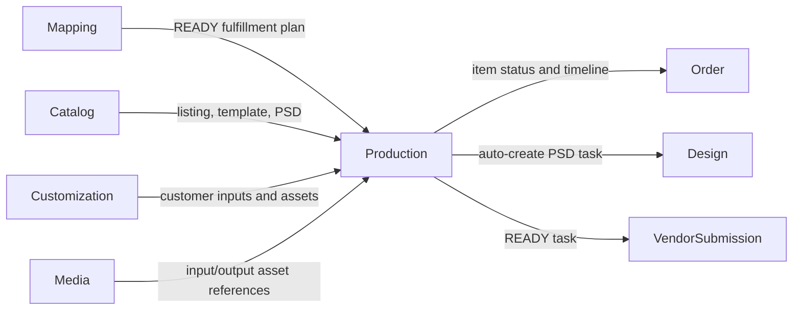
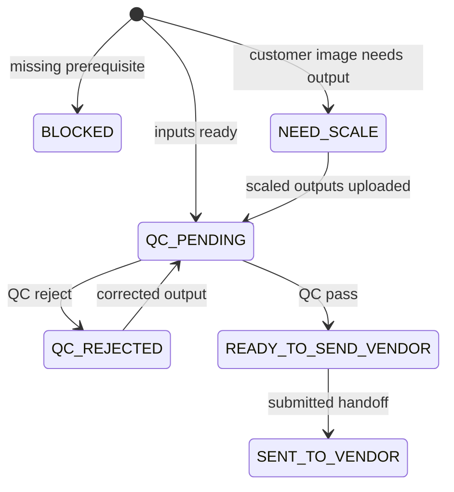

# Production Module Developer Guide

The Production module owns one POD readiness and execution task per Order Item. It assembles Mapping, Catalog, Customization, Media, Order, HR, Organization, Shop, and Vendor reference data into a durable work snapshot, then coordinates scale output, QC, and vendor handoff.

Base path: `/api/production`.

## Boundary



Production stores snapshots and Media ids, not binary files. It does not own fulfillment-plan rules, Catalog records, customization parsing, vendor submissions, or shipments. Cross-module calls use public ports.

## Creation And Recheck

`createOrRecheckTaskForOrderItem()` requires a `READY` fulfillment plan and upserts by unique `orderItemId`. It rebuilds upstream snapshots and file checks while preserving existing scaled outputs. Recheck does not replace lifecycle fields for terminal `QC_REJECTED`, `SENT_TO_VENDOR`, or `CANCELLED` tasks.

Readiness blockers are:

```text
MAPPING_NOT_READY | TEMPLATE_NOT_FOUND | PSD_MISSING
CUSTOMER_IMAGE_MISSING | SCALED_OUTPUT_MISSING | QC_REJECTED
```

A missing PSD triggers best-effort Design task creation. A transition back into `BLOCKED` notifies the assigned designer. Rechecking PSD-blocked tasks is bounded to 100 rows.

## Workflow



Scale mutation is locked after QC passes and for `READY_TO_SEND_VENDOR`, `SENT_TO_VENDOR`, and `CANCELLED`. Upload also requires Order address status `VALID` or `OVERRIDDEN`.

QC pass requires every output-bearing required check to have `outputAssetId`; it clears blockers, transitions the Order Item to `READY_TO_SEND_VENDOR`, and best-effort creates a Vendor Submission. QC rejection records `QC_REJECTED`, updates the Order Item, and notifies the assigned designer.

Mark-sent requires a `SUBMITTED` Vendor Submission belonging to the same task. Production then stores its id and transitions the Order Item to `SENT_TO_VENDOR`.

## File Checks And Media

Each file check identifies a slot, `PSD_TEMPLATE` or `CUSTOMER_IMAGE` source, input/output Media ids, scale state, QC state, and blockers. Customer-image checks require scaled output; template inputs normally do not.

Multipart upload streams through `media.public.storeAsset()` and stores only the returned id. The required provider defaults to `cloudinary` through `PRODUCTION_SCALED_OUTPUT_STORAGE_PROVIDER`; a mismatch fails explicitly. DTOs expose authenticated Media download URLs, never storage paths.

## Assignment Lanes

Production has independent scale/design and CS assignments:

- scale workers require `DESIGN:WORK` eligibility and work on outputs;
- CS assignees require `PRODUCTION:WRITE` eligibility and own follow-up notes/status;
- QC reviewers use `DESIGN:REVIEW` or `PRODUCTION:WRITE`.

Bulk assignment/push operations isolate each task and return successful and failed rows rather than aborting the whole batch.

## Authorization

Queue reads accept `PRODUCTION:READ`, `PRODUCTION:WRITE`, `DESIGN:WORK`, or `DESIGN:REVIEW`, globally or for an exact Shop. Scale work accepts `PRODUCTION:WRITE` or `DESIGN:WORK`; QC accepts `PRODUCTION:WRITE` or `DESIGN:REVIEW`; administrative mutations require `PRODUCTION:WRITE`. Services repeat Shop checks after route authorization.

## Consistency And Audit

Core lifecycle mutations update the Production task, Order Item status/timeline, and central Audit in a Mongo transaction. Some legacy mutations emit Audit best-effort after commit. Automatic Design/Vendor Submission triggers are deliberately best-effort and logged; they do not roll back the Production state.

Mapping override is blocked after vendor submission. Before that point it cancels an active non-submitted submission and clears stale handoff references.

## Public Port

`src/modules/production/public.js` exposes authorization-aware task reads, assignments, scale/QC actions, Order-address synchronization, PSD recheck helpers, mapping-override preparation, and vendor handoff. Other modules must not import internal services or models.

## Endpoint Groups

| Group | Paths |
|---|---|
| Queue | `GET /tasks`, `/tasks/summary`, `/tasks/qc/export` |
| Assignees | `GET /tasks/scale-assignees`, `/tasks/cs-assignees` |
| Assignment/notes | assign, bulk-assign, claim, design-note, assign-cs, cs-note, cs-status task routes |
| Readiness | `GET /order-items/:orderItemId/task`, recheck Order Item/PSD-blocked routes |
| Files/QC | manual/file-check upload routes and `PATCH /tasks/:taskId/qc` |
| Vendor handoff | `POST /tasks/bulk-push-vendor`, `PATCH /tasks/:taskId/sent-to-vendor` |

Filters, payloads, compact projections, and upload examples are in [PRODUCTION_API.md](./PRODUCTION_API.md).

## Change Checklist

- Preserve one task per Order Item and scaled-output retention during recheck.
- Keep task, Order Item, timeline, and Audit mutations transactionally aligned where the current path supports it.
- Validate address, Media, assignment eligibility, QC prerequisites, and exact Shop scope.
- Never expose Media storage paths or modify output after QC pass.
- Keep automatic cross-module triggers best-effort unless a durable queue is explicitly introduced.
- Run `npm test -- --runInBand src/test/production` and the architecture suite.
