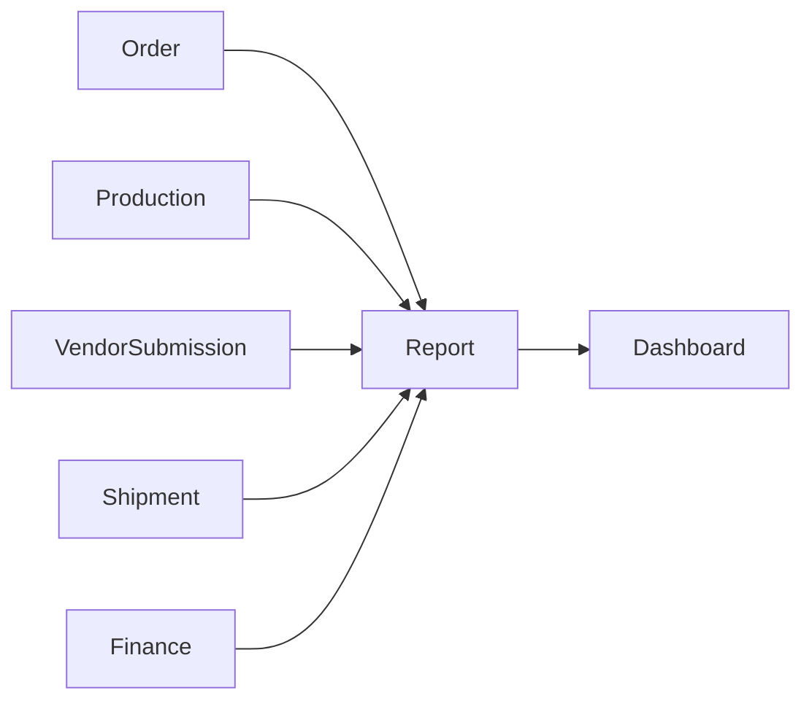

# Report Module Developer Guide

The Report module is a read-only composition layer for dashboards. It applies `REPORTS:READ` Shop scope, queries live read models through module public ports, and shapes compact DTOs. It owns no persistence and exposes no cross-module public API.

Base path: `/api/reports`.

## Boundary

Report must not import another module's models or repositories. Aggregation remains with the owning module; Report only joins compatible aggregate results and formats the response.

## Scope Enforcement

All routes require `REPORTS:READ`, globally or at Shop scope. The service resolves the allowed Shops before invoking downstream ports with a system context. An explicit unauthorized `shopId` yields an empty response, and no Shop scopes yields the endpoint's empty DTO.

Do not pass user-provided scope directly into a privileged downstream call. New reports must follow the same `applyReportScope()` pattern first.

## Report Families

| Family              | Source and purpose                                                                             |
| ------------------- | ---------------------------------------------------------------------------------------------- |
| Finance daily       | Finance Snapshot totals grouped by calculation date/channel/currency.                          |
| Order profitability | Direct per-order P&L from Finance Snapshots; unallocated account-level costs are excluded.     |
| Daily profit        | Finance total-cost P&L with ad spend and net profit.                                           |
| Seller/team         | Finance profitability, seller/team attribution, and operating-cost adjustment.                 |
| Ads                 | Finance ad spend by day, seller, or channel; channel performance joins Order new-buyer counts. |
| Buyer insights      | Order buyer/new-vs-returning aggregates.                                                       |
| Vendor performance  | Vendor Submission status/timing plus Shipment shipped counts.                                  |
| Operations overview | Parallel Order, Production, Vendor Submission, and Shipment status summaries.                  |

Report reads current persisted source/read-model state. They do not trigger Finance recalculation, Production recheck, vendor polling, or any write-side repair.

## Composition Details

Vendor success rate uses `submitted / (submitted + failed)` in basis points; shipped count is joined by Order Item id. Average processing time is returned in hours.

Operations overview runs independent module summaries in parallel. For scoped callers with multiple Shops, Production summaries are executed once per Shop and added together because the Production port accepts one Shop filter at a time.

Finance and ads endpoints emit sensitive-read Audit records with safe filters and row counts. Report Audit data excludes returned financial rows.

## Public Port

`src/modules/report/public.js` is intentionally empty. Report is an HTTP-facing consumer and is not a domain data source for other modules.

## Endpoints

| Path                            | Result                                          |
| ------------------------------- | ----------------------------------------------- |
| `/finance/daily`                | Daily snapshot totals.                          |
| `/finance/orders-profitability` | Paginated direct P&L per order.                 |
| `/finance/daily-profit`         | Daily revenue, deductions, ads, and net profit. |
| `/finance/by-seller`            | Seller profitability.                           |
| `/finance/by-team`              | Team profitability.                             |
| `/buyers/insights`              | Buyer cohort summary.                           |
| `/ads/channel-performance`      | Channel ads plus new buyers.                    |
| `/ads/by-seller`                | Seller-attributed ads.                          |
| `/ads/daily`                    | Daily ad metrics.                               |
| `/ads/seller-daily`             | Daily attributed-ad metrics by employee.        |
| `/vendor/performance`           | Paginated vendor handoff performance.           |
| `/operations/overview`          | Cross-module operational counts.                |

All endpoints are `GET`. Filters and response fields are in [REPORT_API.md](./REPORT_API.md).

## Change Checklist

- Apply Report Shop scope before creating a downstream system context.
- Use only owning-module public ports; keep persistence and business calculations out of Report.
- Return empty DTOs for callers with no allowed scope.
- Do not trigger writes or recalculation from report reads.
- Keep financial Audit metadata bounded and free of row contents.
- Add DTO mapping for every new aggregate field.
- Run `npm test -- --runInBand tests/report` and the architecture suite.
