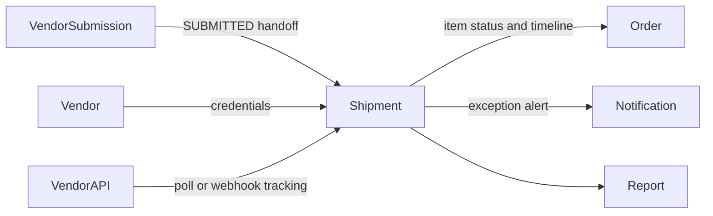
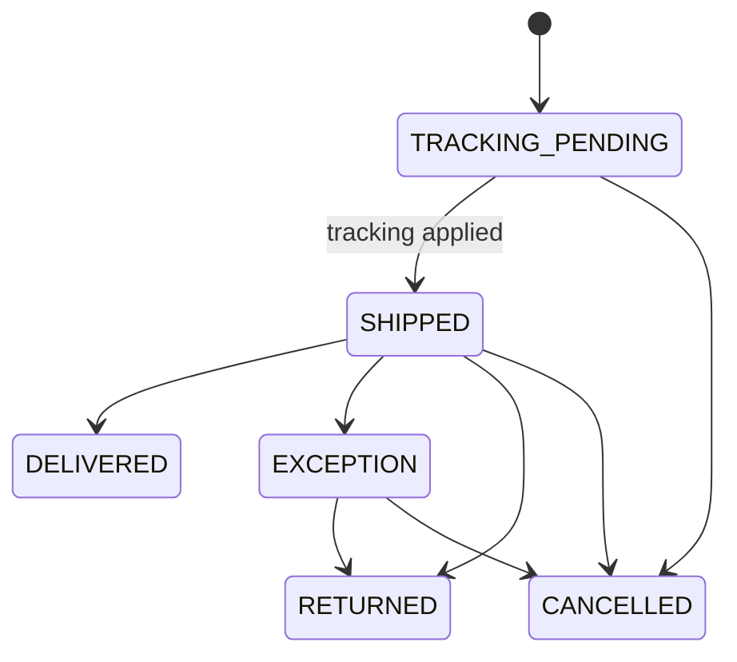

# Shipment Module Developer Guide

The Shipment module owns tracking state after a Vendor Submission is submitted. It creates the per-submission Shipment, accepts manual or vendor-sourced tracking, updates Order lifecycle side effects, receives signed vendor webhooks, and runs optional tracking rechecks.

Base path: `/api/shipments`.

## Boundary

Shipment does not submit vendor orders, buy labels, call carrier APIs, or model multiple packages. Tracking adapters use Vendor credentials through its public port.

## Identity And State Machine

There is at most one non-cancelled Shipment per Vendor Submission. Creation requires a `SUBMITTED` submission, starts at `TRACKING_PENDING`, is duplicate-race safe, and transitions the Order Item to the same tracking-pending state.

`DELIVERED`, `RETURNED`, and `CANCELLED` are terminal. Tracking cannot change after an exception or terminal state. Replaying identical tracking on `SHIPPED` or `DELIVERED` is idempotent and repairs any interrupted Order status/timeline side effect; changed tracking after delivery conflicts.

## Order Handoff

Applying usable tracking sets `SHIPPED`, preserves the first `shippedAt`, transitions the Order Item, and appends an idempotent `TRACKING_AVAILABLE` event. Delivery appends `SHIPMENT_CONFIRMED`; when every non-cancelled Order Item has a delivered Shipment, Shipment marks the parent Order delivered. Exception and return append their own timeline events; exception also sends a best-effort notification to the assigned Order owner.

Shipment persistence can complete before a later Order/timeline handoff fails. Idempotent replay exists to repair those side effects.

## Vendor Tracking

Polling adapters support `LENFUL`, `MERCHIZE`, and `PRINTWAY`.

- Without `vendorSubmissionId`, recheck is read-only and returns normalized tracking.
- With a submitted id, it creates/reuses a pending Shipment and applies only a usable tracking number.
- Batch recheck is capped at 100, skips delivered/returned/cancelled rows, isolates failures, and returns per-row results.
- The optional in-process scheduler is enabled with `VENDOR_TRACKING_RECHECK_ENABLED`; it calls the same bounded batch service.

Provider errors are reduced to safe status/context details before returning to clients.

## Webhooks

Webhook GET verification and POST receipt do not use bearer auth. They require `x-vendor-webhook-secret` or `token`, resolved from provider-specific then global environment configuration.

Payloads are normalized and matched by submission id, Order Item id, or provider plus external vendor order id. Missing submission/tracking returns accepted `SKIPPED` outcomes without shipment mutation. Every attempt writes a sanitized `VendorWebhookLog`; sensitive keys are removed from stored raw payloads.

## Authorization

HTTP reads require `SHIPMENTS:READ`; mutations require `SHIPMENTS:WRITE`, globally or for the exact Shipment Shop. Lists and summaries are narrowed to allowed Shops. Scoped webhook-log readers cannot see unresolved logs with `shopId=null`; global readers can.

## Audit And Public Port

Shipment mutations emit central Audit best-effort after persistence. `src/modules/shipment/public.js` intentionally exposes Order Item lookup, compact summaries by item ids, shipped aggregation, and shipment summary reporting. Other modules must use this port.

## Endpoint Groups

| Group | Paths |
|---|---|
| Reads | `GET /`, `/summary`, `/:id`, `/order-items/:orderItemId` |
| Lifecycle | `POST /from-vendor-submissions/:vendorSubmissionId`, `PATCH /:id/tracking`, `/:id/status` |
| Polling | `POST /vendor-tracking/recheck`, `/vendor-tracking/recheck-submitted` |
| Webhooks | `GET/POST /vendor-webhooks/:provider`, `GET /vendor-webhooks/logs` |

Payloads, environment variables, and tracking safety cases are in [SHIPMENT_API.md](./SHIPMENT_API.md).

## Change Checklist

- Preserve one active Shipment per Vendor Submission and duplicate-race recovery.
- Keep terminal transitions and delivered-tracking immutability strict.
- Make tracking replay safe so Order side effects can be repaired.
- Sanitize webhook/provider payloads and never log secrets.
- Enforce Shop scope on rows and webhook logs.
- Keep batch polling bounded and per-item failure isolated.
- Run `npm test -- --runInBand src/test/shipment` and the architecture suite.
