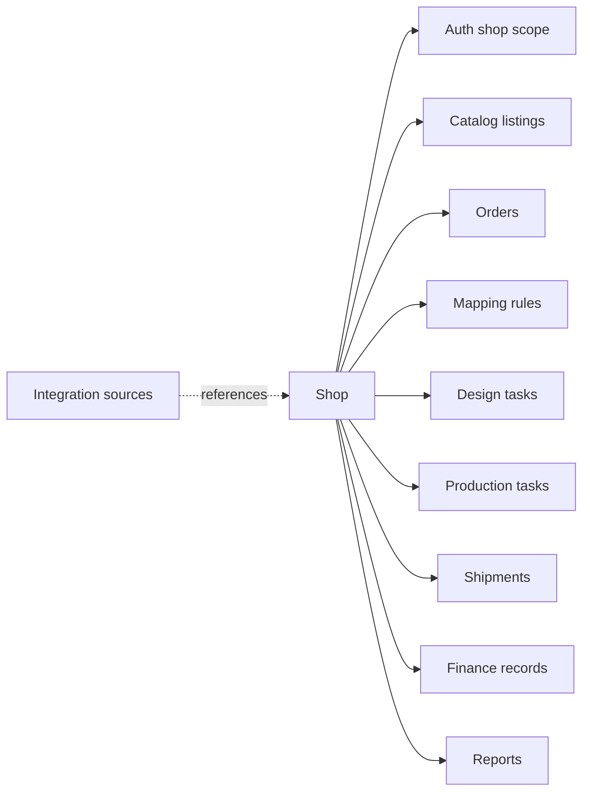
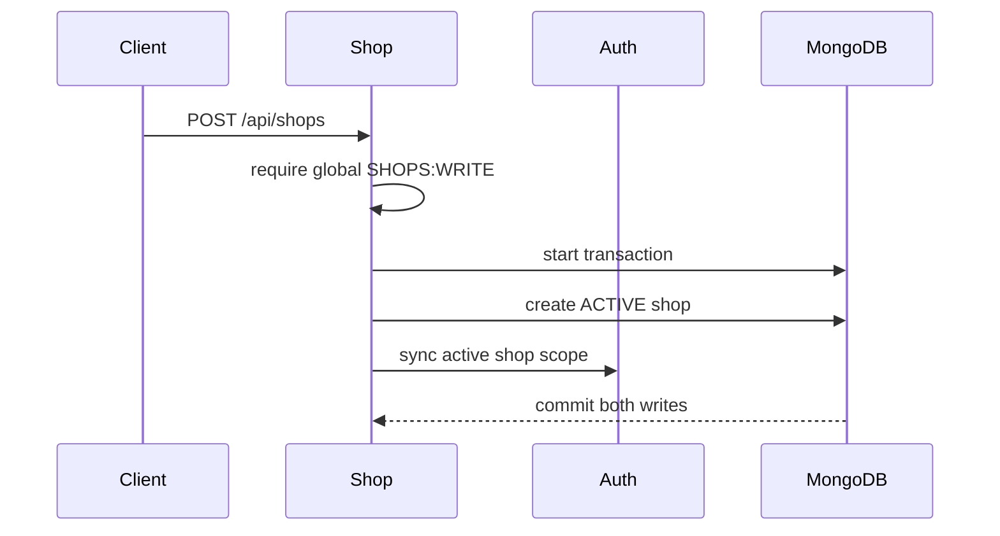
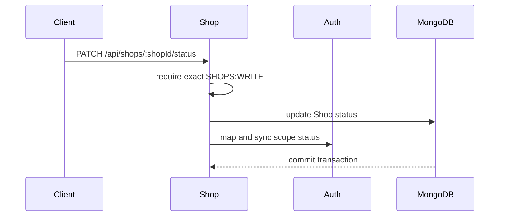

# Shop Module Developer Guide

The Shop module owns the internal business shop/store aggregate used as the stable authorization and data-isolation boundary across the POD platform.

Base path: `/api/shops`.

## Boundary

A Shop is an internal business unit. It is not a marketplace connection, Amazon seller account, Etsy account, Shopify store connection, or vendor account.



Shop stores only:

```text
Shop
  id
  name
  currency   ISO-style 3-letter uppercase code, default USD
  status     ACTIVE | INACTIVE | SUSPENDED
  timestamps
```

Do not add marketplace ids, credentials, tokens, sync cursors, webhook state, listing mappings, or import configuration to Shop. Those belong to Integration, Catalog, or Mapping.

## Shop Identity

`shopId` is the durable business boundary used by downstream records and scoped RBAC. A marketplace code or external seller id must never replace it as an internal foreign key.

Downstream services should persist `shopId` on their own aggregates when they need authorization, filtering, reporting, or historical ownership. They must not join through an external platform identifier to infer the shop later.

## Status And Auth Scope

Every shop has a matching Auth `ScopeRegistry` record:

```text
Shop._id -> scopeType=shop, scopeId=Shop._id
```

Status mapping:

| Shop status | Auth scope status | Operational meaning |
|---|---|---|
| `ACTIVE` | `active` | Available for new operational work. |
| `INACTIVE` | `inactive` | Disabled without representing a compliance hold. |
| `SUSPENDED` | `inactive` | Disabled because work must be held. |

Creating a shop writes the Shop and active Auth scope in one MongoDB transaction. Updating status changes the Shop and scope status in one transaction. If scope synchronization fails, the Shop mutation rolls back.

The current API allows any transition among the three statuses. There is no separate transition matrix or approval workflow.

## Authorization

| Operation | Authorization |
|---|---|
| List shops | Any authenticated account; service filters the result by readable shop scopes. |
| Create shop | Global `SHOPS:WRITE`. |
| Read one active shop | Global or exact shop-scoped `SHOPS:READ`. |
| Change shop status | Global or exact shop-scoped `SHOPS:WRITE`. |

`POST /api/shops` deliberately requires a global permission because it creates a new authorization boundary that cannot already have a shop-scoped grant.

### List filtering

The list service treats these as shop-read permissions:

```text
SHOPS:READ
FINANCE:READ
FINANCE:WRITE
```

If any of them is global, the account can list all shops. Otherwise the repository query is restricted to shop scope ids carrying one of those permissions. No readable ids returns an empty paginated result.

Finance permissions are accepted for list discovery so finance screens can resolve authorized shops. They do not grant `GET /api/shops/:shopId`; detail still requires `SHOPS:READ` for that exact shop.

## Request Flows

### Create



Creation accepts `name` and optional `currency`; status always starts as `ACTIVE`.

### Status change



Status changes do not rewrite downstream orders, listings, or financial history. Consumers decide whether historical reads remain available; creation flows should use the active-shop guard.

## Public Port

Other modules import `src/modules/shop/public.js`. It exposes only:

```js
findById(shopId)
assertShopIsActive(shopId)
```

Use `assertShopIsActive` before creating new shop-owned operational records:

```js
const shopPublic = require('../../shop/public');

await shopPublic.assertShopIsActive(shopId);
```

Behavior:

- missing shop: `404 RESOURCE_NOT_FOUND`;
- `INACTIVE` or `SUSPENDED`: `409 CONFLICT_ERROR`;
- `ACTIVE`: returns the lean Shop record.

Use `findById` for labels, enrichment, or historical reads where a disabled shop must still be visible. Do not use it as a substitute for the active guard on new work.

Current consumers include Order import, Catalog listing creation, Design enrichment, Production enrichment, and Auth scope display enrichment.

## Endpoint Groups

| Method and path | Capability |
|---|---|
| `GET /api/shops` | Scope-filtered paginated list. |
| `POST /api/shops` | Create an active shop and Auth scope. |
| `GET /api/shops/:shopId` | Return one active authorized shop. |
| `PATCH /api/shops/:shopId/status` | Change status and synchronize the Auth scope. |

See [SHOP_API.md](./SHOP_API.md) for query parameters, payloads, and response examples.

## Repository And DTO Rules

- Controllers validate HTTP data and pass `req.auth` to the service where filtering is required.
- The service owns status mapping, authorization-aware list filtering, transactions, and public-port guards.
- The repository owns Mongoose calls and uses lean reads.
- `toShopDto` is the API response shape; never return raw Mongoose documents.
- List search is a case-insensitive name-prefix search, not a general full-text query.

## Development Checklist

When adding a shop-owned flow:

1. Keep `shopId` explicit in the domain record.
2. Validate the shop with `shopPublic.assertShopIsActive()` before creating new work.
3. Use `canAccessScope(auth, permission, { scopeType: 'shop', scopeId })` after loading the target resource.
4. Apply allowed shop ids to list, count, summary, export, and background-trigger queries.
5. Preserve historical records when a shop becomes inactive or suspended.
6. Keep platform connection state outside the Shop model.

## Seeds And Verification

Seed demo shops and synchronize Auth scopes:

```bash
npm run seed:shop:demo
npm run seed:shop:scopes
```

Run tests:

```bash
npm run test:shop -- --runInBand
npm run test:architecture -- --runInBand
```

## Related Documents

- [Shop API](./SHOP_API.md)
- [RBAC developer guide](../auth/RBAC_OVERVIEW.md)
- [Organization module developer guide](../organization/ORGANIZATION_MODULE_GUIDE.md)
