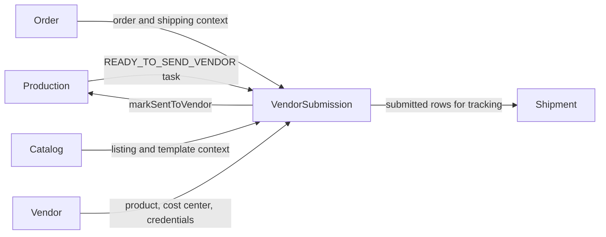
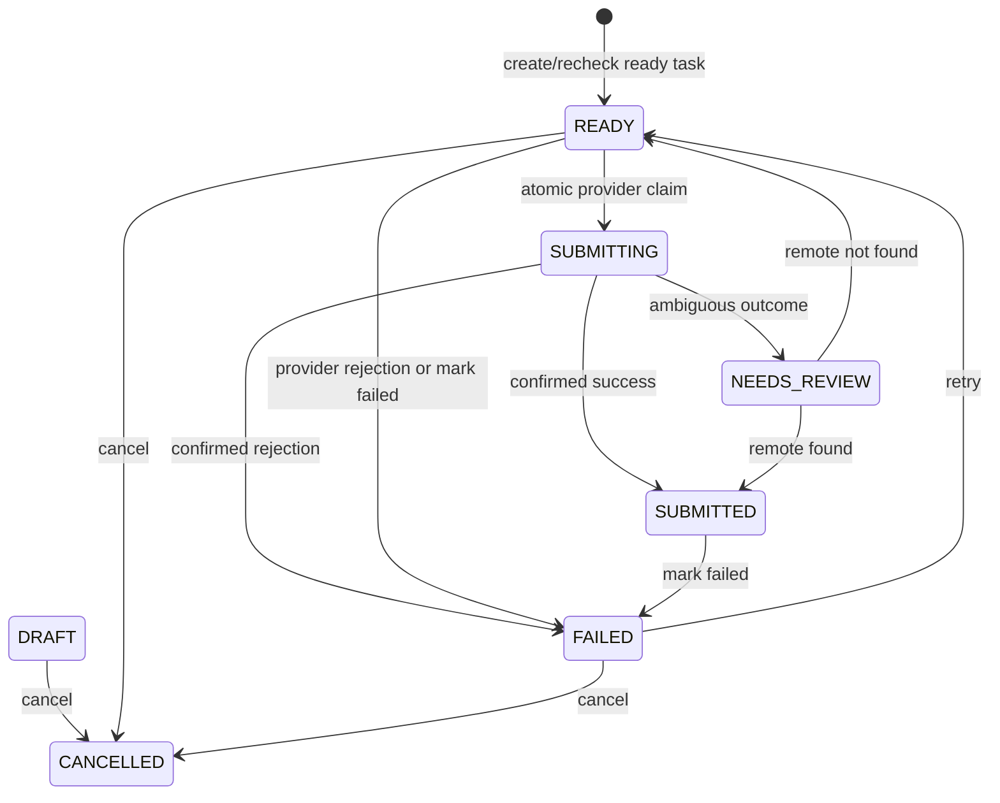

# Vendor Submission Module Developer Guide

The Vendor Submission module owns the durable handoff between a Production task and an external vendor. It snapshots the handoff payload, tracks retries and terminal state, invokes supported provider adapters, and reports submission performance. It does not create Production tasks, Shipments, or Finance records.

Base path: `/api/vendor-submissions`.

## Boundary And Snapshot

Creation copies the order item, listing/template, vendor product, vendor cost center, quantity, design-output checks, and Production readiness checks into `payloadSnapshot`. Only one non-cancelled submission may exist for a Production task. Creation is idempotent and handles duplicate-key races; cancelling frees the task for a later submission.

## State Machine

`SUBMITTED` cannot be cancelled. Retry preserves the previous failure fields as evidence and appends status history. The model still supports `DRAFT`, but normal creation currently writes `READY`.

## Creation And Recheck

The source Production task must be `READY_TO_SEND_VENDOR`, and the caller needs write access to its exact Shop. Rechecking one task is an alias of idempotent creation. Batch recheck processes at most 100 ready Production tasks and returns a per-task outcome.

## Provider Submission

`submit-to-vendor` derives `MERCHIZE`, `PRINTWAY`, or `LENFUL` and its credential from the snapshotted vendor mapping. Dry-run defaults to `true`: it builds and validates a safe payload without an external call or state change.

On live success, the service stores a sanitized provider response and external order id, marks the submission `SUBMITTED`, then calls `production.public.markSentToVendor()`. The submission is already committed if that later Production handoff fails.

A provider rejection or local validation/setup error is persisted as `FAILED`. An ambiguous transport outcome is persisted as `NEEDS_REVIEW`; it must be reconciled after provider lookup and is never automatically retried.

## Authorization And Reads

HTTP reads require `VENDOR_SUBMISSIONS:READ`; actions require `VENDOR_SUBMISSIONS:WRITE`. Services enforce exact Shop scope from the linked submission or Production task. List and summary queries are restricted to allowed Shops and return no rows when the caller has no applicable scope.

Payload preview and dry-run responses remove local/storage paths, credentials, tokens, and other unsafe provider data.

## Public Port

`src/modules/vendorSubmission/public.js` exposes submission lookup by id, Order Item, Production task, or provider external order id; latest rows for task ids; submitted rows for Shipment tracking; cancellation/creation; and performance summaries used by reporting. Cross-module callers must not import internal models or repositories.

## Audit And Notifications

Each lifecycle transition appends embedded `statusHistory`. Central Audit emission is best-effort and does not roll back a committed transition. A failed submission also sends a best-effort Notification to the assigned Order owner; notification failure does not change the submission result.

## Endpoint Groups

| Group | Paths |
|---|---|
| Reads | `GET /`, `/summary`, `/:id`, `/:id/payload-preview` |
| Create/recheck | `POST /from-production-tasks/:productionTaskId`, `/recheck/production-tasks/:productionTaskId`, `/recheck-ready-production-tasks` |
| Submission | `POST /:id/mark-submitted`, `/:id/submit-to-vendor` |
| Recovery | `POST /:id/reconcile`, `/:id/mark-failed`, `/:id/retry`, `/:id/cancel` |

Payloads and operator examples are in [VENDOR_SUBMISSION_API.md](./VENDOR_SUBMISSION_API.md).

## Change Checklist

- Preserve one active submission per Production task and idempotent duplicate handling.
- Enforce exact Shop scope before creating or mutating a submission.
- Keep dry-run side-effect free and sanitize all provider data returned or stored.
- Do not claim cross-module atomicity after the submission write.
- Keep cancellation forbidden after `SUBMITTED` and retain status history on retry.
- Use target-module public ports for every upstream/downstream call.
- Run `npm test -- --runInBand src/test/vendorSubmission` and the architecture suite.
